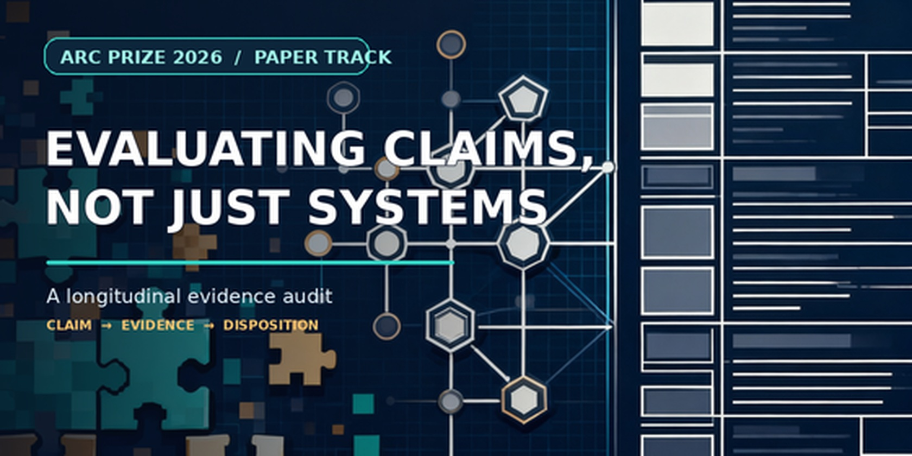
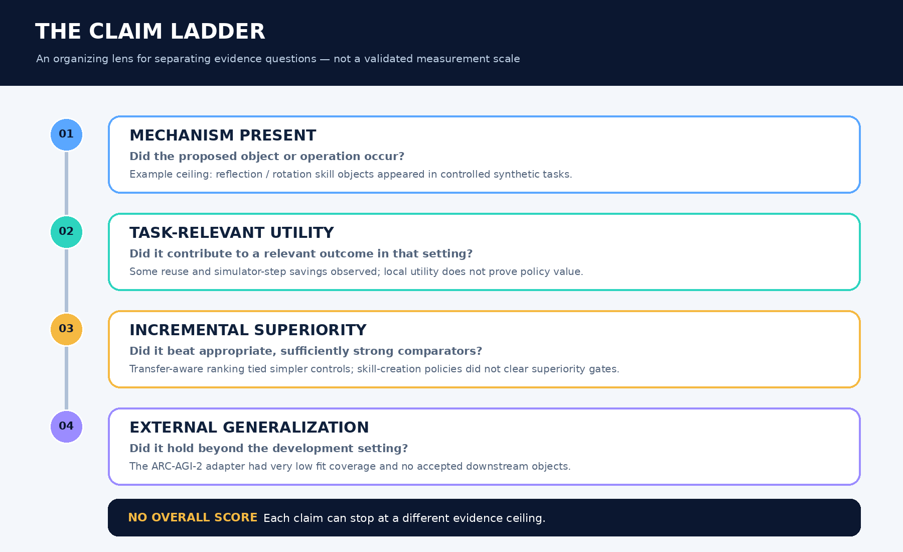
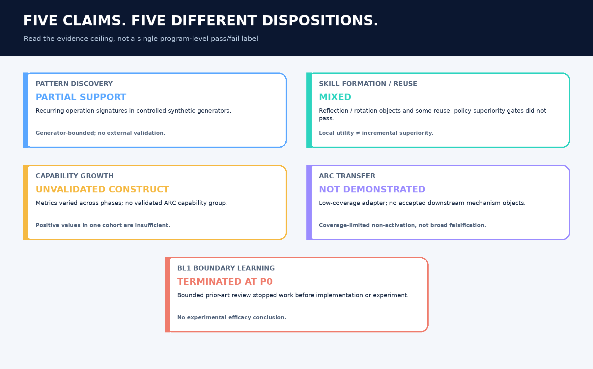
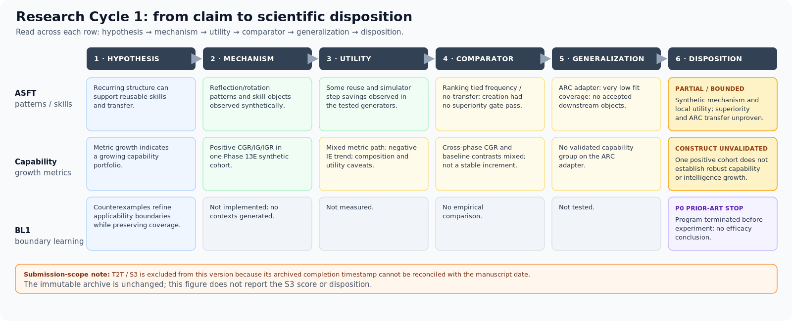
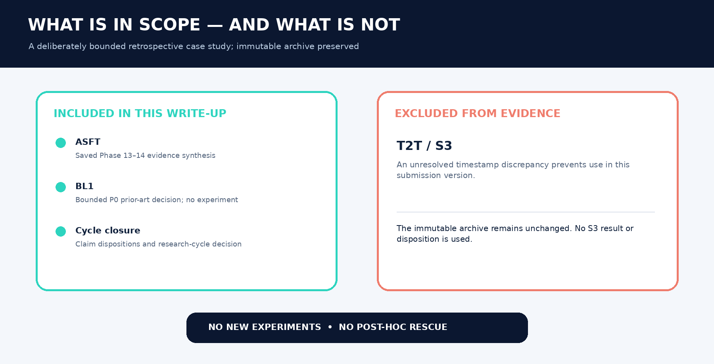

# Evaluating Claims, Not Just Systems

### A longitudinal evidence audit of one ARC research program

**ARC Prize 2026 — Paper Track submission**
**Research Cycle 1: CLOSED (2026-11-05)**
**Repository state: archived research record, not an active research program. No experiment, benchmark run, or implementation is currently authorized.**



---

**Contents:** [What this repository is](#what-this-repository-is) · [Paper and submission package](#the-paper-and-submission-package) · [The claim ladder](#the-claim-ladder) · [Final dispositions](#final-dispositions) · [What the evidence supports](#what-the-evidence-supports) · [**All failed hypotheses**](#all-failed-hypotheses) · [Why the project failed where it did](#why-the-project-failed-where-it-did) · [Repository map](#repository-map) · [Reproducing the prototype](#reproducing-the-prototype) · [Research-cycle disposition](#research-cycle-disposition)

---

## What this repository is

This is the complete archive of **Research Cycle 1**, an ARC-motivated research program that began as *Adaptive Skill Formation Theory (ASFT)* and ended as a **claim-audit case study**.

It contains three things at once:

1. **A working research prototype** — a fully implemented synthetic pipeline for traces, recurrence detection, invariant candidates, skill creation, reuse, transfer, and capability metrics (`src/`).
2. **The experimental record** — frozen Phase 13 evidence packages, Phase 14 critical analyses, negative-evidence registers, and the final scientific scorecard (`reports/experiments/`).
3. **The submission-facing paper** — *Evaluating Claims, Not Just Systems: A Longitudinal Audit of an ARC Research Program* (`submission_package/`).

The project did **not** produce a validated ARC solver, a benchmark score, or a successful successor program. What it produced is a traceable answer to a narrower question:

> **What conclusions remain defensible when the claims in one ARC-motivated research cycle are separated by mechanism occurrence, task-relevant utility, incremental superiority, and external generalization?**

The answer is a disposition map, not a single verdict. Pattern discovery received partial support; skill formation and reuse were mixed; capability growth remained an unvalidated construct; ARC transfer was not demonstrated; T2T Claim N failed its frozen synthetic test; and BL1 was terminated at P0 on prior-art grounds before any experiment.

---

## The paper and submission package

| Artifact | File |
|---|---|
| Typeset manuscript (PDF) | [`submission_package/paper.pdf`](submission_package/paper.pdf) |
| Visual companion (PDF) | [`submission_package/visual_overview.pdf`](submission_package/visual_overview.pdf) |
| Editable manuscript | [`submission_package/paper_editable.docx`](submission_package/paper_editable.docx) |
| Manuscript source (Markdown) | [`submission_package/paper_source_v4.md`](submission_package/paper_source_v4.md) |
| Kaggle writeup copy | [`submission_package/KAGGLE_WRITEUP_READY_TO_PASTE.md`](submission_package/KAGGLE_WRITEUP_READY_TO_PASTE.md) |
| Project description (plain text) | [`submission_package/PROJECT_DESCRIPTION_PLAIN_TEXT.txt`](submission_package/PROJECT_DESCRIPTION_PLAIN_TEXT.txt) |
| Upload manifest | [`submission_package/UPLOAD_MANIFEST.md`](submission_package/UPLOAD_MANIFEST.md) |

**Title:** Evaluating Claims, Not Just Systems
**Subtitle:** A longitudinal evidence audit of one ARC research program
**Article type:** longitudinal claim-audit case study / empirical evaluation analysis

### Submission scope note

The submission-facing v4 manuscript **excludes T2T/S3** from its abstract, empirical narrative, table, and figure. The immutable S3 execution record has a completion timestamp of **2026-11-05**, later than the manuscript date **2026-10-28**, and no independent contemporaneous source has resolved the discrepancy. The archive is preserved unchanged; no S3 result or disposition is used in the paper. The full T2T record remains in this repository and is summarized below under [T2T / S3 and BL1](#7-t2t--s3-and-bl1).

The literature screen accompanying the paper is **purposive, not systematic**. The paper makes no field-wide prevalence claim and no priority claim.

---

## The claim ladder

The audit uses four distinct evidence questions. They are an organizing lens, **not a validated measurement framework**, and they are not strictly sequential.



| Level | Question | What it does *not* establish |
|---|---|---|
| **1. Mechanism present** | Did the proposed object or operation occur in the specified setting? | That it helps, generalizes, or beats anything |
| **2. Task-relevant utility** | Did it contribute to a success or cost proxy in that setting? | That the policy is the source of the gain |
| **3. Incremental superiority** | Did it beat an appropriate, sufficiently strong comparator under a matched protocol? | That the effect transfers beyond the tested population |
| **4. External generalization** | Did it hold beyond the development generator or benchmark? | Anything, if the chain never activated |

---

## Final dispositions

These are the five claims retained in the submission-facing paper. They have different evidence ceilings and are deliberately **not** collapsed into one success/failure grade.



| Claim | Evidence type and result | Disposition | Claim ceiling |
|---|---|---|---|
| **Pattern discovery** | Synthetic; recurring operation signatures observed across seeds | **PARTIAL SUPPORT** | Generator-bounded; no external validation |
| **Skill formation and reuse** | Synthetic; reflection/rotation skills and step savings observed; creation-policy gates tied or failed | **MIXED** | Local utility does not establish policy superiority or ARC transfer |
| **Capability growth** | Mixed synthetic metrics across phases; no validated capability group on the ARC adapter | **UNVALIDATED CONSTRUCT** | Positive metric values in one cohort do not establish robust capability or intelligence growth |
| **ARC transfer** | Bounded adapter; very low coverage and no accepted downstream objects | **NOT DEMONSTRATED** | Coverage-limited non-activation, not broad ARC falsification |
| **BL1 boundary learning** | Bounded prior-art review; no implementation or experiment | **TERMINATED AT P0** | Novelty/program decision only; no efficacy conclusion |

### The evidence-supported chain

```
Experience → Recurring trace patterns → Synthetic skills → Synthetic transfer
```

That much was demonstrated inside a controlled, known four-family generator. Everything after transfer remains unsupported:

```
Transfer → Capability growth → Intelligence growth        ❌ not established
ARC task → Trace → Invariant → Skill → Transfer → Capability → IG   ❌ never activated
```

The first scientific break in the synthetic chain is **transfer → capability growth**, not invariant discovery or skill formation. The first break in the ARC chain is **representation**, not theory: more than 99% of ARC tasks never entered the pipeline.



---

## What the evidence supports

These conclusions are defensible **within the tested synthetic scope**:

- Reasoning traces can be captured, normalized, segmented, and mined for recurring operation-level structures.
- Recurrence detection is repeatable across seeds and reasonably robust to generator-level perturbation (VST = 1.0; top-rank overlap ≈ 72% under noise).
- Reflection and rotation skill objects can be constructed from validated candidates and reused successfully.
- Skill reuse produced measurable reductions in a **simulator reasoning-step cost proxy** (mean normalized reduction ≈ 0.227 in Phase 13C), and that reduction survived a reuse-accounting correction.
- Near, moderate, and cross-family synthetic transfer events occurred repeatedly; negative transfer was detectable and correctly earned no reward.
- The software pipeline runs end to end and the contract tests exercise it.
- Phase 14A's evidence-integrity audit found that failed gates, null ablations, adverse effects, and the ARC non-activation were preserved rather than hidden or relabeled.

## What the evidence does not support

- General or open-ended invariant discovery.
- Invariant strength (IS) as a reliable predictor of future transfer.
- Transfer-aware ranking superiority over frequency-only or no-transfer ranking.
- SCT or SCV superiority over always-create, random-create, or memory-only policies.
- Causal necessity of SCT, SCV, lifecycle management, or composition.
- Capability growth as a robust phenomenon, or as a predictor of future performance.
- IG/IGR as measures of intelligence growth.
- ARC-AGI-2 mechanism replication, ARC transfer, or ARC capability growth.
- Any end-to-end validation of the full ASFT causal chain.
- Any external-validity claim beyond the synthetic generator.

---

## All failed hypotheses

This section is the core of the final record. Every failed or unsupported hypothesis in the cycle is listed with its test and disposition. Nothing here was post-hoc rescued, threshold-tuned, or reclassified as successful.

### 1. Invariant Discovery Theory (IDT)

| Hypothesis | Test / result | Verdict |
|---|---|---|
| **IDT-1 (strong form):** ASFT discovers general, open-ended invariants | Discovery is real but operation-level, in a generator that shares vocabulary with the solver and labels | ❌ Strong form unsupported; narrow synthetic form ✅ |
| **IDT-2:** Invariant strength predicts future transfer | Phase 13B showed Pearson ≈ 1.0 on ~4.4 promoted candidates/seed; Phase 13D corrected analysis gave **r = −0.042** (CI touching zero) | ❌ **Not established** |
| **IDT-3:** Transfer-aware ranking beats frequency-only ranking | Phase 13B primary endpoint: ASFT = frequency = no-transfer at TU **0.095809**, paired difference **0.000000** | ❌ **Primary gate failed** |
| **EXP-IDT-14:** Transfer-aware ranking wins once a frequent useless pattern is injected | Deliberately confounded stress test created *after* the original tie; ASFT top-1 TU 0.164866 vs frequency 0 | ⚠ **Exploratory only** — does not repair the gate |
| **ARC invariant discovery** | Phase 13G: 0 invariant candidates from a 10-program adapter covering 3/600 discovery tasks | ❌ **Not demonstrated** |

### 2. Skill Creation Trigger Theory (SCT)

| Hypothesis | Test / result | Verdict |
|---|---|---|
| **SCT-1 (strong form):** skills emerge broadly from validated invariants | 44 candidate rows across 10 seeds, but births limited to reflection/rotation; zero count or grouping skills | ❌ Strong form unsupported; narrow form ✅ |
| **SCT-2:** SCV predicts future skill value | SCV ρ = 0.700, but frequency ρ = 0.748 and `p_reuse` ρ = 0.884 | 🟡 **Partially supported** — signal, not superiority |
| **SCT-3:** SCT outperforms naive creation policies | SCT = always-create = random-create at **0.345**; memory-only **1.325** | ❌ **Not supported** |
| **SCV necessity** | No-SCV and random-SCV ablations tied SCT (contrast = 0) | ❌ **Not supported** |
| **Lifecycle necessity** | Lifecycle off ≈ lifecycle on | ❌ **Not established** |
| **Composition creates capabilities** | Rotation→reflection composition worked (0% → 100%, cost reduction 0.429), but only one pair; Phase 13E composition value **−0.1429** and 0/10 capability-count gains | 🟡 Mixed / ❌ for the capability claim |
| **ARC skill emergence** | 0 skills on the bounded ARC adapter | ❌ **Not demonstrated** |

**Why SCT failed as a policy test:** every eligible candidate had SCV > 0, so SCT selected everything. The experiment never forced a difficult rejection. That is a benchmark-property finding, not proof that the theory is wrong — but it means superiority was not tested, let alone shown.

### 3. Transfer

| Hypothesis | Test / result | Verdict |
|---|---|---|
| **TR-1:** Skills transfer across tasks | 201 positive-credit reuses; near, moderate, and cross-family transfer observed | ✅ Synthetic scope |
| **TR-2:** Transfer reduces reasoning cost | Mean normalized reduction ≈ 0.227; incorrect replays earned zero benefit | ✅ Strongly supported (simulator proxy) |
| **TR-3:** Transfer drives capability growth | Phase 13D mean CGR **−0.060**; Phase 13E TS→CGR **r = −0.503**, CI includes zero | ❌ **Not established** |
| **TR-4:** Transfer beats all non-transfer baselines | Beat B1/B2/B3; **lost to B4 compression proxy** | ❌ **Not supported** |
| **Structural / multi-skill transfer** | Required CountSkill and GroupingSkill never existed; composition coverage absent | ⚪ **Unavailable** — not a null result |
| **ARC transfer** | 0 skills, 0 capabilities, no transfer chain | ❌ **Not demonstrated** (chain never activated) |

### 4. Capability Growth Metrics (CGM)

| Hypothesis | Test / result | Verdict |
|---|---|---|
| **CGM-1:** Capabilities emerge from skills | Capability cluster persisted 10/10 seeds, but 0 accepted higher-order capabilities and 0/10 post-composition gains | 🟡 Aggregation, not demonstrated emergence |
| **CGM-2:** Capabilities grow robustly over time | Phase 13E mean CGR **0.2946** [0.2857, 0.3036], but Phase 13D corrected mean CGR **−0.060** | 🟡 Generator- and phase-dependent |
| **CGM-3:** Capability growth predicts future performance | TS→CGR r = −0.5027, CI [−0.860, 0.186]; preregistered C_t→next-round utility r = 0.0498 | ❌ **Not supported** |
| **CGM-4:** Intelligence growth can be measured | IG = 0.2294, IGR = 0.00904, but IE slope **−0.00394**; no external criterion | ❌ **Not established** |
| **CGM-5:** Capability growth is a proxy for intelligence growth | CGR and IG rise together partly because they are mathematically linked; no behavioral validation | ❌ **Not supported** |
| **ARC capability / IG** | No capability group formed; IG unavailable | ❌ **Not demonstrated** |

### 5. Baselines and ablations

| Competing explanation | Result | Verdict |
|---|---|---|
| **B1 — no learning:** learning is unnecessary | ASFT beat B1 on 13D transfer utility, but lost to B1 on 13E and 13F task utility (13E: **−0.0361**) | 🟡 Mixed |
| **B2 — memory only:** memory explains everything | Phase 13C memory-only **1.325** vs SCT **0.345** | ❌ **Alternative survives** |
| **B3 — random skills:** any skill creation works | ASFT beat random in 13B/13D, but random-create tied SCT in 13C because everything was promoted | 🟡 Partially supports SCT only under selection pressure |
| **B4 — compression proxy:** compression explains everything | **ASFT < B4**; mandatory all-baseline criterion failed in 13D | ❌ **Alternative survives** |
| **IDT ablation** | Some degradation, not universal | 🟡 Partial |
| **SCT ablation** | Often no measurable change (all candidates selected anyway) | ❌ **Not established** |
| **SCV / lifecycle ablation** | Exact ties | ❌ **Not supported** |
| **Randomness** | ASFT generally beat random systems | ✅ Rejected as sole explanation |

**The surviving alternatives are memory, retrieval, and compression.** They are the strongest threat to the project's original novelty story, and the paper reports them as such rather than claiming universal superiority.

### 6. ARC-AGI-2 adapter

| Hypothesis | Result | Verdict |
|---|---|---|
| ASFT mechanisms replicate on ARC | Exact demonstration-fit coverage: **3/600** discovery, **5/200** transfer, **2/200** holdout | ❌ **Coverage-limited non-activation** |
| Invariants/skills/capabilities form | **0 / 0 / 0**; IG unavailable | ❌ **Not demonstrated** |
| Main arms differ on holdout accuracy | ASFT 1/200 and baselines 1/200 (0.5%) | ❌ **No difference** |

This is a **representation and DSL-coverage failure**, not a clean falsification of IDT, SCT, transfer, or CGM. The bounded adapter also carried a candidate-budget configuration/code mismatch and reused the holdout after an earlier attempt wrote predictions before a report-writing failure. Those caveats are disclosed, not laundered.

### 7. T2T / S3 and BL1

These lines are part of the research cycle but **not** part of the submission-facing paper's evidence.

| Hypothesis | Test / result | Verdict |
|---|---|---|
| **T2T Claim N:** an explicit invariant representation adds predictive value beyond the strongest fair source-derived replay/compiler | Frozen finite synthetic suite: I0 **105/105**, R4 **105/105**, `Delta_N = 0` | ❌ **N-FAIL** (decision-grade, frozen estimand) |
| **T2T Claim A:** invariant skills help in the known generator | Partial synthetic support only | 🟡 Partial synthetic |
| **T2T Claim B:** counterexample evidence improves applicability boundaries | One deterministic toy fixture: false activations 2/4 → 0/4, coverage 2/2 | ⚠ **Toy-fixture pass only** |
| **T2T Claims C/D/E** | No experiment | ⚪ **Untested** |
| **BL1:** counterexample-guided applicability-boundary learning is a novel contribution | Bounded P0 prior-art review found direct overlap with learned option initiation sets and counterexample-guided refinement | ❌ **TERMINATED AT P0** before implementation or experiment |

**Claim N closure:** the S3 protocol was frozen, the comparator received an independent fairness PASS, one authorized execution completed with no deviations or reruns, and predictions were committed before outcomes were accessed. The result is an interpretable tie, not a blocked test. No rerun, comparator weakening, post-hoc subset, or N-v2 rescue is permitted. Claim N v1 is permanently closed.

**BL1 closure:** the broad mechanism — using negative/failure evidence to revise where a skill or option is eligible — is established prior art, including Bagaria et al. (NeurIPS 2023) on initiation sets and the explicit precision/usefulness tradeoff. The bounded review is not a systematic review and claims no absence of prior art. No BL1 implementation, context generation, or experiment occurred.

**Why S3 is excluded from the paper:** the execution record's `completed_at` is 2026-11-05, after the manuscript date of 2026-10-28. Rather than backdate the manuscript, edit the immutable record, or present 105/105 as contemporaneously verified, the submission omits S3 entirely and records the discrepancy in [`docs/research_notes/s3_provenance_date_reconciliation.md`](docs/research_notes/s3_provenance_date_reconciliation.md). Any future reinstatement requires independent date verification and a separate provenance note.

### 8. Cycle-level hypothesis

| Hypothesis | Result | Verdict |
|---|---|---|
| A descendant research program is justified (ASFT v3, T2T v2, BL2, Harness/Adapter/Human-Process P0) | No candidate phenomenon cleared scientific interest, prior-art novelty, contribution clarity, and plausible paper path simultaneously | ❌ **No evidence-validated successor program** |



---

## Why the project failed where it did

The Phase 14 audit separated the failures by type instead of reporting one program-level verdict.

| Failure | Type | What it means |
|---|---|---|
| Transfer-aware ranking tied frequency-only | **Benchmark discriminability** | Inside `synthetic-v1`, useful = frequent, so the rankings chose identical candidates |
| SCT tied always-create | **No selection pressure** | All candidates had SCV > 0; the policy was never forced to reject |
| SCV/lifecycle ablations tied | **Component non-necessity in the frozen setting** | The machinery existed but was not exercised |
| Capability metrics were inconsistent across phases | **Construct validity** | CGR may track skill accumulation, not capability |
| IG positive but IE negative | **Interpretation validity** | The metric moved; the construct was not validated |
| ARC produced 0/0/0 | **Representation bottleneck** | The adapter never converted most tasks into ASFT-compatible experience |
| Claim N tied at 105/105 | **Strong replay/compiler sufficiency** | The source-derived Boolean compiler reproduced I0 on the frozen suite |
| BL1 stopped before P1 | **Prior-art novelty** | Not an efficacy result and not an experimental failure |

The dominant risk identified in Phase 14I is not that the experiments were performed incorrectly. It is that **internally consistent synthetic metrics could be read as evidence of general capability growth, intelligence growth, or ARC-relevant learning** when the evidence does not justify that reading.

---

## Repository map

```
src/
  core/            task, trace, invariant, skill, capability, state contracts
  solver/          deterministic four-family synthetic generator + rule-aware solver
  traces/          trace logging, normalization, segmentation, similarity, storage
  invariants/      pattern mining, candidates, validation/ranking, robustness, transfer-aware logic
  skills/          skill economics, creation/promotion, library, retrieval, lifecycle, composition
  transfer/        transfer memory, reuse engine, transfer metrics
  capability/      capability representation and growth
  evaluation/      metrics, growth/intelligence, statistics, reporting, baselines
  representations/ representation adapters
  pipelines/       trace → invariant → skill → evaluation → full ASFT pipeline
  t2t_eventlog/    append-only event journal and schema (Step 1 plumbing)
  t2t_s2/          T2T-S2 synthetic toy mechanism check
  t2t_s3/          T2T-S3 frozen Claim N implementation (N-FAIL)

experiments/       EXP-01–05, Phase 13A–13H runners, EXP-IDT-14
configs/           task/seed policy, thresholds, labels, metrics, experiments
reports/
  experiments/     Phase 13 evidence packages, Phase 14 analyses, T2T-S3 record
  competition/     claim–evidence map and paper-track strategy
  figures/         generated experiment figures
docs/
  00_project/      status, roadmap, readiness
  01_research/     literature, thesis, contributions, novelty, experimental design
  02_design/       architecture, metrics, invariants, skills, transfer, capability specs
  03_implementation/ plans, validation records, Phase 14 results analysis
  04_paper/        experiment map and claim traceability
  05_trace_to_transfer/ T2T P0–P7 design packets, S1–S3, BL1
  research_notes/  case-study drafts, landscape, ranking, closure, provenance
submission_package/ paper PDF/DOCX/Markdown, figures, Kaggle writeup copy
tests/             contract, pipeline, metric, and experiment tests
validation/        hypothesis register, protocols, templates, repository review
```

### Where to read the final record

| Question | Read |
|---|---|
| What evidence file supports each paper claim? | [`docs/04_paper/claim_evidence_index.md`](docs/04_paper/claim_evidence_index.md) |
| What is the paper's claim ceiling? | [`reports/experiments/PHASE-14J-FINAL-SCIENTIFIC-CONCLUSIONS-V1/publication_claim_ceiling.md`](reports/experiments/PHASE-14J-FINAL-SCIENTIFIC-CONCLUSIONS-V1/publication_claim_ceiling.md) |
| What failed, with numbers? | [`PHASE-13H negative evidence register`](reports/experiments/PHASE-13H-EVIDENCE-CONSOLIDATION-V1/negative_evidence_register.csv) |
| How was each contribution analyzed? | [`docs/03_implementation/results_analysis/`](docs/03_implementation/results_analysis/) (14A–14J) |
| Why did ARC fail? | [`phase_14g.md`](docs/03_implementation/results_analysis/phase_14g.md) |
| What threatens validity? | [`phase_14i.md`](docs/03_implementation/results_analysis/phase_14i.md) |
| What is the final program verdict? | [`phase_14j.md`](docs/03_implementation/results_analysis/phase_14j.md) |
| Why is S3 excluded from the paper? | [`s3_provenance_date_reconciliation.md`](docs/research_notes/s3_provenance_date_reconciliation.md) |
| What happened to Claim N? | [`claim_n_archive.md`](docs/05_trace_to_transfer/claim_n_archive.md) |
| Why was BL1 stopped? | [`boundary_prior_art_review.md`](docs/05_trace_to_transfer/bl1/boundary_prior_art_review.md) |
| Why is there no successor program? | [`research_cycle_1_closure.md`](docs/research_notes/research_cycle_1_closure.md) |

---

## Reproducing the prototype

### Install

```bash
pip install -e .
# or
pip install -r requirements.txt
```

Python 3.10+.

### Run the end-to-end synthetic pipeline

```bash
python -c "from pipelines.full_asft_pipeline import run_full_asft_pipeline; print(run_full_asft_pipeline().summary)"
```

### Run the recorded experiments

```bash
python experiments/exp05_end_to_end/run.py
python experiments/idt_experiments.py
python -m experiments.phase13c.cli confirm
python -m experiments.phase13d.cli --run
```

Phase 13E–13G use explicit confirmation flags: `python -m experiments.phase13e.cli --confirm` (likewise `.phase13f.cli` and `.phase13g.cli`). The Phase 13E–13G runners refuse to overwrite existing artifacts. Experiments write into `reports/`; the saved Phase 13 and Phase 14 records are the authoritative evidence. Rerunning regenerates artifacts but does not create new scientific evidence and must not be used to revise a frozen disposition.

### Run the tests

```bash
python -m pytest -q
```

**Verification status in this checkout (Windows):** the core suite is green — **612 passed** — when the POSIX-only event-journal module and the v1.1 readiness/human-review gate modules are excluded. Those modules depend on `fcntl` or on POSIX path/commit behavior and fail to collect or run on this platform; they are not part of the ASFT evidence chain. The core suite excludes:

```bash
python -m pytest -q \
  --ignore=tests/test_t2t_eventlog.py \
  --ignore=tests/test_phase2ia_ai_pilot_boundary.py \
  --ignore=tests/test_phase2ia_runner.py \
  --ignore=tests/test_phase2ia_wp3_provisional_boundary.py \
  --ignore=tests/test_wp3_human_review.py \
  --ignore=tests/test_wp3_provisional_annotation.py
```

### Rebuild the submission package

The package was assembled on Linux with `reportlab`, `python-docx`, `Pillow`, and `cairosvg`:

```bash
python scripts/build_submission_package.py
```

The script contains hard-coded Linux paths (`/home/user/reasonflux`, `/usr/share/fonts/truetype/dejavu/...`) and must be path-adjusted before reuse on another machine. Rebuilding regenerates the PDF, DOCX, card, and diagrams; it does not add experiments or change claims.

---

## Research-cycle disposition

From [`docs/research_notes/research_cycle_1_closure.md`](docs/research_notes/research_cycle_1_closure.md):

| Line | Final disposition |
|---|---|
| ASFT v1 | **CLOSED** |
| ASFT v2 | **CLOSED** |
| T2T Claim N | **CLOSED — N-FAIL** on its frozen finite synthetic estimand |
| BL1 | **TERMINATED AT P0** on prior-art overlap |
| Candidate Phenomena Ranking | **COMPLETE** |

**No candidate phenomenon currently survives all four criteria simultaneously:** scientific interest, prior-art novelty, contribution clarity, and a plausible paper path. The current evidence does not justify a new research program, including ASFT v3, T2T v2, BL2, or the Harness, Adapter, and Human-Process P0 lines.

The next state is **observation mode only**. No protocol, experiment, or implementation is authorized or underway.

## What survives

Not a theory — a set of validated negatives, a working testbed, and an auditable method:

- **A testbed:** a complete synthetic trace → invariant → skill → transfer → metric pipeline.
- **A negative-result map:** memory and compression remain strong competitors; selection pressure was absent; capability and intelligence metrics lack construct validation; ARC coverage was the binding constraint.
- **An evaluation method:** the claim ladder and evidence ledger, applied retrospectively and reported with its own provenance boundary.
- **Reusable records:** frozen manifests, hashes, execution records, scoring contracts, and an append-only event schema.
- **A clean scientific stop:** the program ended without a post-hoc rescue, a threshold change, or a relabeled failure.

## Citation

```bibtex
@misc{asft_claim_audit_2026,
  title  = {Evaluating Claims, Not Just Systems: A Longitudinal Audit of an ARC Research Program},
  year   = {2026},
  note   = {ARC Prize 2026 Paper Track submission; Research Cycle 1 archive},
  url    = {https://www.kaggle.com/competitions/arc-prize-2026-paper-track/writeups/evaluating-claims-not-just-systems}
}
```

## Editorial note

Avoid "the missing layer in ARC research" and "most ARC work evaluates systems rather than claims" unless a reproducible, systematically coded corpus review later supports them. The defensible thesis is narrower: **claim-level evaluation makes one research cycle's evidence boundaries visible**, and in this cycle those boundaries did not coincide.
