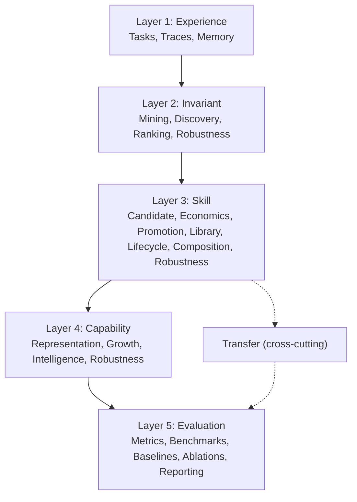

# ASFT v0.1 Implementation Blueprint (Phase 11F)

Implementation-ready build specification. Source of truth for module status is
[`configs/modules.yaml`](../../configs/modules.yaml), enforced by
`tests/test_spec_module_registry.py` and `tests/test_spec_claim_traceability.py`.

**Rule:** a module is only `implemented` when its public entry point imports and
its behavior is covered by a test. Everything else is `partial` or `stub`.

## Build hierarchy

Layers map to contributions: Layer 2 = IDT, Layer 3 = SCT, Layer 4 = CGM,
Layer 5 = evidence for all three.

## Module registry

Status legend: `implemented` (entry point + tests), `partial` (libraries real,
at least one entry point a stub), `stub` (nothing real yet).

| ID | Module | Layer | Phase | Status | Code home | Metric | Contribution |
| --- | --- | --- | --- | --- | --- | --- | --- |
| M01 | Task System | 1 | A | implemented | `src/core/task.py` | TFD | foundation |
| M02 | Reasoning Trace System | 1 | A | partial | `src/core/trace.py`, `src/traces/` | TC | foundation |
| M03 | Experience Memory | 1 | A | partial | `src/core/memory.py`, `src/traces/trace_store.py` | — | foundation |
| M04 | Trace Mining Engine | 2 | B | partial | `src/invariants/pattern_mining.py`, `detector.py` | IER | IDT |
| M05 | Invariant Discovery Engine | 2 | B | partial | `src/invariants/validator.py`, `validation/` | IS, VST | IDT |
| M06 | Invariant Ranking Engine | 2 | B | implemented | `src/invariants/ranking.py`, `promotion.py` | IS | IDT |
| M07 | Invariant Robustness System | 2 | B | implemented | `src/invariants/robustness/` | VST, NTR, IER | IDT |
| M08 | Skill Candidate System | 3 | C | implemented | `src/skills/candidate.py`, `birth.py` | — | SCT |
| M09 | Skill Economics Engine | 3 | C | implemented | `src/skills/economics.py`, `utility.py` | SCV, SU, AG | SCT |
| M10 | Skill Promotion Engine | 3 | C | partial | `src/skills/promotion.py`, `pipeline.py` | SCV, SU | SCT |
| M11 | Skill Library | 3 | C | implemented | `src/skills/library.py`, `retrieval.py` | ASU, TSU, PU | SCT |
| M12 | Skill Lifecycle Manager | 3 | C | implemented | `src/skills/lifecycle/`, `retirement.py` | SU, UG | SCT |
| M13 | Skill Composition Engine | 3 | C | implemented | `src/skills/composition/` | SU, PU | SCT |
| M14 | Skill Robustness Engine | 3 | C | implemented | `src/skills/robustness/` | NTR, SU, NTB | SCT |
| M15 | Capability Representation System | 4 | E | implemented | `src/capability/models.py`, `library.py` | PU | CGM |
| M16 | Capability Growth Engine | 4 | E | implemented | `src/evaluation/growth_metrics.py` | CGR, UG, AG | CGM |
| M17 | Intelligence Growth Engine | 4 | E | implemented | `src/evaluation/intelligence*.py` | IG, AG, SU, TS, CGR | CGM |
| M18 | Capability Robustness Engine | 4 | E | implemented | `src/capability/robustness/` | CGR | CGM |
| M19 | Metrics Engine | 5 | F | partial | `src/evaluation/*_metrics.py` | IS, SU, TS, CGR, IG | CGM |
| M20 | Benchmark Engine | 5 | F | partial | `src/evaluation/harness/` | TS, CGR, IG | ASFT |
| M21 | Baseline Engine | 5 | F | partial | `src/evaluation/harness/baselines.py`, `baselines/` | SU, TS | ASFT |
| M22 | Ablation Engine | 5 | F | implemented | `src/evaluation/harness/baselines.py` | CGR, IG | ASFT |
| M23 | Reporting Engine | 5 | F | partial | `src/evaluation/reports.py` | — | ASFT |
| T1 | Transfer Engine | 3 | D | partial | `src/transfer/` | TS, ITS, TU, NTR | transfer |

Counts: 24 modules — 14 implemented, 10 partial, 0 stubs. Every `partial`
module owns at least one entry in the stub inventory below.

## Dependency order (MVP phases)

| Phase | Modules | Goal | Exit gate |
| --- | --- | --- | --- |
| A Foundation | M01, M02, M03 | Generate reliable traces | Traces are produced and retrievable by task and family |
| B IDT | M04, M05, M06, M07 | Discover and trust invariants | Reflection and rotation invariants above the IS floor |
| C SCT | M08, M09, M10, M11, M12, M13, M14 | Skills emerge when economic | Reflection skill promoted, low-value candidate rejected |
| D Transfer | T1 | Task A helps Task B | Positive ITS outranks zero-transfer noise |
| E CGM | M15, M16, M17, M18 | Capability and intelligence grow | Positive CGR and IG with fake-growth rejection |
| F Evaluation | M19, M20, M21, M22, M23 | Research evidence | Baselines beaten, ablations degrade, artifacts emitted |

Phases are strictly ordered: each consumes the previous phase's contract in
[`src/core/contracts.py`](../../src/core/contracts.py).

## Pipeline entry points

Two different kinds of "done" exist: library functions (callable and tested) and
pipeline entry points (one call that chains a whole phase).

| Entry point | File | Status |
| --- | --- | --- |
| `run_evaluation_pipeline` | `src/pipelines/evaluation_pipeline.py` | implemented |
| `create_skills_from_invariants` | `src/skills/pipeline.py` | implemented |
| `validate_and_rank` | `src/invariants/validator.py` | implemented |
| `audit_capability_ecosystem` | `src/capability/robustness/audit.py` | implemented |
| `run_trace_pipeline` | `src/pipelines/trace_pipeline.py` | stub |
| `run_invariant_pipeline` | `src/pipelines/invariant_pipeline.py` | stub |
| `run_skill_pipeline` | `src/pipelines/skill_pipeline.py` | stub |
| `run_full_asft_pipeline` | `src/pipelines/full_asft_pipeline.py` | stub |

Phases B–E therefore work **as libraries** but are not yet chained into a single
command. Phase A has no producer at all: nothing writes traces, so the pipeline
currently starts at synthetic scenarios in
[`src/evaluation/harness/scenarios.py`](../../src/evaluation/harness/scenarios.py).

## Stub inventory

These raise `NotImplementedError` today and are named in `configs/modules.yaml`.

| File | Symbol | Owner | Blocks |
| --- | --- | --- | --- |
| `src/traces/logger.py` | `TraceLogger.log` | M02 | Phase A trace capture |
| `src/pipelines/trace_pipeline.py` | `run_trace_pipeline` | M02 | Phase A trace capture |
| `src/traces/trace_store.py` | `TraceStore.save` / `.load` | M03 | durable experience memory |
| `src/traces/trace_similarity.py` | `trace_similarity` | M04 | trace deduplication |
| `src/invariants/cluster.py` | `cluster_traces` | M04 | trace clustering |
| `src/pipelines/invariant_pipeline.py` | `run_invariant_pipeline` | M05 | Phase B pipeline |
| `src/pipelines/skill_pipeline.py` | `run_skill_pipeline` | M10 | Phase C pipeline |
| `src/transfer/reuse_engine.py` | `ReuseEngine.apply` | T1 | Phase D skill reuse |
| `src/evaluation/invariant_metrics.py` | `compute_is` | M19 | IS reporting |
| `src/pipelines/full_asft_pipeline.py` | `run_full_asft_pipeline` | M20 | Phase F end-to-end evidence |
| `src/utils/visualization.py` | `plot_metric` | M23 | paper figures |
| `src/utils/logging.py` | `get_logger` | M23 | shared logging |
| `baselines/no_learning/__init__.py` | docstring-only package | M21 | standalone baselines |

## Implementation contract for each module

Every module, regardless of layer, must satisfy:

1. **Single responsibility** matching its registry row; no cross-layer writes.
2. **Typed boundary** — input/output objects come from `src/core` or a
   `configs/thresholds.yaml` dataclass.
3. **No magic numbers** — thresholds are injected from config.
4. **Evidence or refusal** — a positive claim without supporting evidence is
   rejected, never soft-passed.
5. **File budget** — every module file ≤ 300 lines.
6. **Test coverage** — at least one test per public function; one end-to-end test
   per phase.

## Non-goals for v0.1

Locked in `configs/modules.yaml` under `non_goals:` and enforced by
`tests/test_spec_claim_traceability.py`:

LLM planner · autonomous agent · meta-reasoner · world model · recursive
self-improvement · concept graph engine · neural skill embeddings · ARC
leaderboard optimizer · multi-agent architecture · AGI framework.

If any of these appears in `src/`, the spec test fails.

## Related documents

- [claim_traceability.md](../04_paper/claim_traceability.md) — claim → module → metric → experiment → artifact
- [v0_1_readiness.md](../00_project/v0_1_readiness.md) — go/no-go per gate
- [architecture.md](architecture.md) — repository layout
- [metrics.md](metrics.md) — formulas
