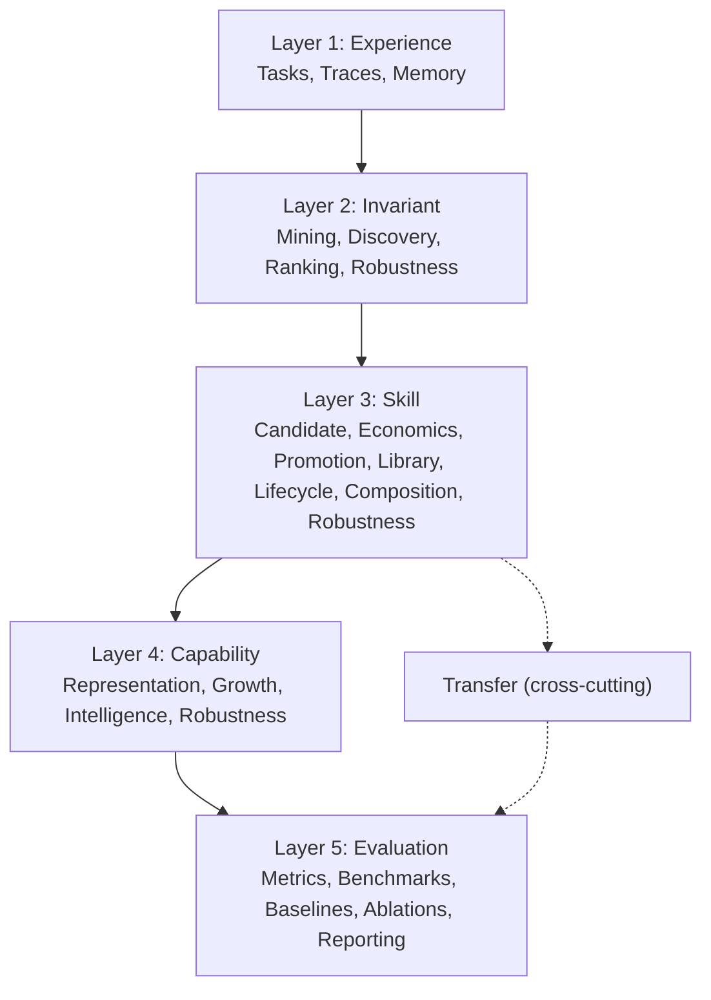

# ASFT v0.1 Implementation Blueprint (Phase 11F)

Implementation-ready build specification. Source of truth for module status is
[`configs/modules.yaml`](../../configs/modules.yaml), enforced by
`tests/test_spec_module_registry.py` and `tests/test_spec_claim_traceability.py`.

**Rule:** a module is only `implemented` when its public entry point imports and
its behavior is covered by a test.

**Status: complete.** All 24 modules are `implemented`, all six MVP gates are
`demonstrated`, and no file under `src/` raises `NotImplementedError`.

## Build hierarchy

Layers map to contributions: Layer 2 = IDT, Layer 3 = SCT, Layer 4 = CGM,
Layer 5 = evidence for all three.

## Module registry

Status legend: `implemented` (entry point + tests), `partial` (libraries real,
at least one entry point a stub), `stub` (nothing real yet).

| ID | Module | Layer | Phase | Status | Code home | Metric | Contribution |
| --- | --- | --- | --- | --- | --- | --- | --- |
| M01 | Task System | 1 | A | implemented | `src/core/task.py`, `src/solver/tasks.py` | TFD | foundation |
| M02 | Reasoning Trace System | 1 | A | implemented | `src/solver/executor.py`, `src/traces/` | TC | foundation |
| M03 | Experience Memory | 1 | A | implemented | `src/core/memory.py`, `src/traces/trace_store.py` | TC | foundation |
| M04 | Trace Mining Engine | 2 | B | implemented | `src/invariants/pattern_mining.py`, `detector.py` | IER | IDT |
| M05 | Invariant Discovery Engine | 2 | B | implemented | `src/invariants/validator.py`, `sct_priors.py` | IS, VST | IDT |
| M06 | Invariant Ranking Engine | 2 | B | implemented | `src/invariants/ranking.py`, `promotion.py` | IS | IDT |
| M07 | Invariant Robustness System | 2 | B | implemented | `src/invariants/robustness/` | VST, NTR, IER | IDT |
| M08 | Skill Candidate System | 3 | C | implemented | `src/skills/candidate.py`, `birth.py` | SCV | SCT |
| M09 | Skill Economics Engine | 3 | C | implemented | `src/skills/economics.py`, `utility.py` | SCV, SU, AG | SCT |
| M10 | Skill Promotion Engine | 3 | C | implemented | `src/skills/promotion.py`, `pipeline.py` | SCV, SU | SCT |
| M11 | Skill Library | 3 | C | implemented | `src/skills/library.py`, `retrieval.py` | ASU, TSU, PU | SCT |
| M12 | Skill Lifecycle Manager | 3 | C | implemented | `src/skills/lifecycle/`, `retirement.py` | SU, UG | SCT |
| M13 | Skill Composition Engine | 3 | C | implemented | `src/skills/composition/` | SU, PU | SCT |
| M14 | Skill Robustness Engine | 3 | C | implemented | `src/skills/robustness/` | NTR, SU, NTB | SCT |
| M15 | Capability Representation System | 4 | E | implemented | `src/capability/models.py`, `emerge.py` | PU | CGM |
| M16 | Capability Growth Engine | 4 | E | implemented | `src/evaluation/growth_metrics.py` | CGR, UG, AG | CGM |
| M17 | Intelligence Growth Engine | 4 | E | implemented | `src/evaluation/intelligence*.py` | IG, AG, SU, TS, CGR | CGM |
| M18 | Capability Robustness Engine | 4 | E | implemented | `src/capability/robustness/` | CGR | CGM |
| M19 | Metrics Engine | 5 | F | implemented | `src/evaluation/*_metrics.py` | IS, SU, TS, CGR, IG | CGM |
| M20 | Benchmark Engine | 5 | F | implemented | `src/evaluation/harness/`, `src/pipelines/full_asft_pipeline.py` | TS, CGR, IG | ASFT |
| M21 | Baseline Engine | 5 | F | implemented | `baselines/`, `harness/baselines.py` | SU, TS | ASFT |
| M22 | Ablation Engine | 5 | F | implemented | `src/evaluation/harness/baselines.py` | CGR, IG | ASFT |
| M23 | Reporting Engine | 5 | F | implemented | `src/evaluation/reports.py`, `utils/visualization.py` | CGR, IG | ASFT |
| T1 | Transfer Engine | 3 | D | implemented | `src/transfer/`, `transfer/reuse_engine.py` | TS, ITS, TU, NTR | transfer |

Counts: 24 modules — 24 implemented, 0 partial, 0 stubs.

## Dependency order (MVP phases)

| Phase | Modules | Goal | Exit gate |
| --- | --- | --- | --- |
| A Foundation | M01, M02, M03 | Generate reliable traces | Traces produced and retrievable by task and family |
| B IDT | M04, M05, M06, M07 | Discover and trust invariants | Reflection and rotation invariants above the IS floor |
| C SCT | M08–M14 | Skills emerge when economic | SCV admits justified skills, rejects at a prohibitive threshold |
| D Transfer | T1 | Task A helps Task B | Credited transfer, including cross-family, never for wrong runs |
| E CGM | M15, M16, M17, M18 | Capability and intelligence grow | Positive CGR and IG; fake growth rejected |
| F Evaluation | M19–M23 | Research evidence | ASFT beats all four baselines; artifacts emitted |

Phases are strictly ordered: each consumes the previous phase's contract in
[`src/core/contracts.py`](../../src/core/contracts.py).

## Pipeline entry points

| Entry point | File | Status |
| --- | --- | --- |
| `run_trace_pipeline` | `src/pipelines/trace_pipeline.py` | implemented |
| `run_invariant_pipeline` | `src/pipelines/invariant_pipeline.py` | implemented |
| `run_skill_pipeline` | `src/pipelines/skill_pipeline.py` | implemented |
| `ReuseEngine.apply` | `src/transfer/reuse_engine.py` | implemented |
| `run_full_asft_pipeline` | `src/pipelines/full_asft_pipeline.py` | implemented |
| `run_evaluation_pipeline` | `src/pipelines/evaluation_pipeline.py` | implemented |

The chain is fully wired: tasks → traces → invariants → skills → reuse →
capability growth → reports.

## Measured baseline comparison

From `experiments/exp05_end_to_end` (seed 0), on identical evaluation tasks:

| System | Capability | CGR | IG | Credited transfers |
| --- | --- | --- | --- | --- |
| ASFT full | 0.831 | +0.0133 | 0.278 | 27 |
| DreamCoder-like | 0.683 | 0.000 | 0.102 | 6 |
| Random skill creation | 0.520 | 0.000 | 0.078 | 6 |
| Skill storage only | 0.000 | 0.000 | 0.000 | 6 |
| No learning | 0.000 | 0.000 | 0.000 | 0 |

Ordering matches the theory: economic selection with transfer verification
outperforms frequency-only compression, which outperforms random creation, which
outperforms no learning.

## Stub inventory

**None.** No file under `src/` raises `NotImplementedError`. This is asserted by
`tests/test_spec_module_registry.py::test_no_stubs_remain`.

## Implementation contract for each module

Every module, regardless of layer, must satisfy:

1. **Single responsibility** matching its registry row; no cross-layer writes.
2. **Typed boundary** — input/output objects come from `src/core` or a
   `configs/thresholds.yaml` dataclass.
3. **No magic numbers** — thresholds are injected from config.
4. **Evidence or refusal** — a positive claim without supporting evidence is
   rejected, never soft-passed.
5. **File budget** — every module file ≤ 300 lines.
6. **Test coverage** — at least one test per public function; one end-to-end test
   per phase.

## Non-goals for v0.1

Locked in `configs/modules.yaml` under `non_goals:` and enforced by
`tests/test_spec_claim_traceability.py`:

LLM planner · autonomous agent · meta-reasoner · world model · recursive
self-improvement · concept graph engine · neural skill embeddings · ARC
leaderboard optimizer · multi-agent architecture · AGI framework.

If any of these appears in `src/`, the spec test fails.

## Related documents

- [claim_traceability.md](../04_paper/claim_traceability.md) — claim → module → metric → experiment → artifact
- [v0_1_readiness.md](../00_project/v0_1_readiness.md) — go/no-go per gate
- [architecture.md](architecture.md) — repository layout
- [metrics.md](metrics.md) — formulas
