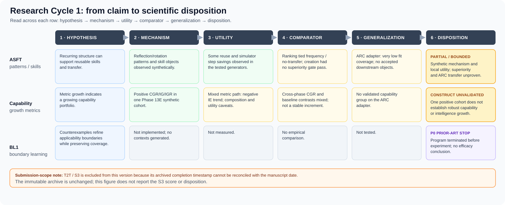

> **Superseded working draft:** Use `arc_claim_evaluation_case_study_draft_v3.md` for the current version with the timeline, claim-disposition table, revised tone, and explicit provisional status of S3.

# Evaluating Claims, Not Just Systems
## A Retrospective Case Study of ARC Research

**Manuscript status:** internal revised draft; not submission-ready pending S3 provenance resolution. This is a longitudinal claim-audit case study, not a negative-results paper.  
**Evidence basis:** immutable Research Cycle 1 archive plus a preliminary, purposive prior-literature screen. No new benchmark run, implementation, experiment, or statistical re-analysis is reported.  
**Submission hold:** the S3 record is timestamped **2026-11-05**, later than this manuscript date, **2026-10-28**. The archived outcome is retained as recorded and visibly marked provisional; resolve the date or remove the S3 claim before submission. See §2.4.  
**Proposed article type:** longitudinal claim-audit case study / empirical evaluation analysis.  

### Abstract

ARC research already includes benchmark design, concept-focused evaluation, controlled generalization studies, system comparisons, and component ablations. We present a longitudinal audit of one ARC-motivated research cycle, tracing claims from mechanism occurrence through task-relevant utility, incremental superiority, external generalization, and final disposition. In ASFT, recurring operation-level patterns and reflection/rotation skill objects appeared in controlled synthetic tasks, with some measured reuse and simulator-step savings; transfer-aware ranking tied simpler controls, skill-creation policies did not establish incremental superiority, capability metrics were mixed across phases, and a low-coverage ARC-AGI-2 adapter did not activate the downstream mechanism chain. The archived S3 record reports identical predictions for invariant representation I0 and replay/compiler R4 on 105 held-out synthetic cases (105/105 each), classified N-FAIL for that finite estimand; its date provenance remains unresolved. BL1 stopped after a bounded prior-art review, before an efficacy experiment. The audit's central finding is that one program can contain positive observations, failed superiority tests, blocked endpoints, a bounded negative result, and a pre-experiment novelty decision—and each calls for a different claim ceiling. We contribute an auditable, cross-claim case account, not a new ARC solver, a validated universal methodology, or a diagnosis of the field.

**Keywords:** ARC-AGI; evaluation methodology; claim-evidence mapping; comparator design; generalization; synthetic task; retrospective case study

## 1. Introduction

A benchmark score, an implemented mechanism, a component ablation, and a transfer claim answer different questions. A system may produce the proposed representation without that representation improving task outcomes; a component may improve a controlled synthetic endpoint without outperforming a stronger alternative; a within-benchmark effect may fail to transfer to a new task family. Treating these as one claim can make evidence appear stronger—or weaker—than it is.

ARC work already contains important evaluation contributions. ConceptARC organizes tasks around concepts and tests abstraction/generalization against human and machine solvers [1]. Controlled ARC-domain studies test compositional generalization across methods [2]. ARC Prize technical reports discuss score interpretation, hidden-set reuse, compute, and benchmark design [3, 4], while method papers include component ablations [5, 6]. This case study builds on that evaluation tradition. Its unit of analysis is the linked research program: how claims move from a proposed mechanism to observed utility, comparison, generalization, and disposition. The accompanying literature screen is purposive, so we make no prevalence claim about ARC papers as a whole.

Instead, we ask a narrower question:

> **What conclusions remain defensible when the claims in one ARC-motivated research cycle are separated by mechanism occurrence, task-relevant utility, incremental superiority, and external generalization?**

Research Cycle 1 moves through three linked lines: ASFT develops and tests recurring-structure, skill, transfer, and capability claims; T2T Claim N compares an invariant representation with replay/compiler on a finite synthetic suite; BL1 stops at a prior-art gate. The audit maps what was observed, what gained or lost against a comparator, what could not be tested, and what was stopped before an experiment.

*Figure 1. Research Cycle 1 from hypothesis to disposition. The S3 box is explicitly marked as a provenance hold: its archived date is later than the manuscript date and must be reconciled before submission.*

We contribute a **retrospective application** of a claim ladder and an evidence ledger. The case's value is its traceable disposition map: one research program contains positive observations, failed superiority tests, mixed metrics, blocked transfer, a finite negative result, and a pre-experiment novelty decision. These outcomes remain separate rather than being collapsed into a single success/failure narrative.

## 2. Scope and audit method

### 2.1 Research lines included

The audit covers four linked records, not four equivalent experiments:

- **ASFT:** the saved Phase 13–14 synthesis of synthetic prototypes, comparator studies, capability metrics, and the bounded ARC-AGI-2 adapter.
- **T2T Claim N:** the one authorized S3 execution comparing invariant representation I0 with replay/compiler R4 on a finite synthetic predictive suite.
- **BL1:** a bounded P0 prior-art review of counterexample-guided applicability-boundary learning. There was no implementation or experiment.
- **Research Cycle 1 closure:** the disposition record and decision not to authorize a descendant research program.

Later ASFT v1.1 candidate-production readiness work is mentioned only as readiness/plumbing context. It is not an ARC efficacy result: independent annotation was incomplete and no real ARC candidate-production run occurred.

### 2.2 Claim ladder

We use the following ladder as an **organizing lens**, not a validated measurement framework:

1. **Mechanism present:** did the software or method produce the proposed object/operation in the specified setting?
2. **Task-relevant utility:** did the object or operation contribute to a relevant outcome, such as success or a cost proxy, in that setting?
3. **Incremental superiority:** did the proposed mechanism improve the outcome over an appropriate, sufficiently strong comparator under a matched protocol?
4. **External generalization:** did the result hold beyond the development generator, benchmark split, or narrowly tested model/task condition?

The ladder is not always strictly sequential. A pre-experiment prior-art decision, for example, is not evidence for or against any of the four empirical layers. Nor does a utility effect automatically establish policy superiority: the observed utility may be available to simpler baselines as well.

### 2.3 Evidence categories and source records

Each audited conclusion is labeled as one of the following:

- **Narrow synthetic support:** an operational behavior occurred in a controlled, known generator; external validity and superiority remain separate questions.
- **Comparative support/failure:** a frozen contrast met or failed its stated criterion on its specified benchmark and estimand.
- **Mixed / partial:** support varies across measures, phases, comparators, or related constructs.
- **Unavailable / blocked:** a required candidate, label, component, or run was absent. This is not a null effect.
- **Prior-art termination:** a proposed contribution was judged substantially covered before testing. This is not an experimental result.

The synthesis uses the saved Phase 13H and Phase 14J packages, the permanent S3 execution record and decision, the T2T claim archive and evidence map, the BL1 P0 review, and the Research Cycle 1 closure. It does not pool outcomes across different generators, endpoints, candidate pools, or seed structures; no new effect estimate is calculated. Earlier artifacts are not modified. The literature screen reported separately in `claim_isolation_prior_art.md`, `arc_comparator_survey.md`, and `arc_evaluation_methodology_review.md` is purposive, not systematic, and is used only to qualify the novelty framing.

### 2.4 Archive integrity and date reconciliation

The S3 record identifies a completed, single authorized execution with predictions committed before outcome access, zero protocol deviations, and zero reruns. It also records `completed_at = 2026-11-05`. The current manuscript preparation date is 2026-10-28, so that execution timestamp is in the future relative to this draft. This is a provenance/date inconsistency that cannot be resolved by inference. We preserve the accepted archived result as recorded and do not rerun, edit, or reinterpret S3. **The manuscript must not be submitted until the owner explains and documents the date discrepancy through an appropriate provenance correction or confirms the actual manuscript date/cutoff.** The immutable execution artifact itself must remain unchanged.

### 2.5 Comparison discipline

- A primary tie is not evidence of equivalence beyond the frozen test.
- A negative result is restricted to its stated estimand and decision rule.
- A synthetic result is not an ARC result.
- An implementation/readiness pass is not efficacy evidence.
- An unavailable endpoint is not zero effect.
- A prior-art stop is not an experimental failure.
- A cross-paper score table is not a matched causal comparison unless data, model, budget, and protocol are aligned.

## 3. Case findings through the claim ladder

### 3.1 ASFT: occurrence and local utility did not establish incremental superiority

Within controlled synthetic task generators, the implemented pipeline detected recurring operation-level patterns, formed reflection/rotation skill objects, recorded successful reuse, and measured reductions in a simulator reasoning-step proxy. Phase 13C recorded 44 candidate rows across its confirmation seeds, with observed births limited to reflection/rotation. This is **narrow mechanism-occurrence evidence** in designed synthetic environments, not open-ended invariant discovery or external validation.

There was also **bounded local utility evidence**: some skill reuse and simulator-step savings were observed. But these did not establish that the ASFT policies added value over simpler alternatives. Transfer-aware ranking tied frequency-only and no-transfer variants on the original Phase 13B primary top-k comparison. The later injected-no-op stress test was exploratory and does not repair that failed gate. On Phase 13C's primary net-value endpoint, SCT tied ALWAYS_CREATE and RANDOM_CREATE and was below MEMORY_ONLY; the report notes an opportunity-matching caveat. SCV's association with shadow future value did not demonstrate incremental policy benefit over frequency and `p_reuse` controls.

**Claim ceiling:** some mechanisms occurred and some local outcomes improved, but the tested ranking and creation policies did not establish incremental superiority on their main comparisons. ARC generalization is a separate unproven layer.

### 3.2 Capability metrics: positive values were not a validated growth construct

Phase 13E reported positive repository-defined CGR/IG/IGR values and persistent low-order capabilities in one synthetic cohort. The same evidence includes a negative IE trend, zero accepted higher-order emergent capabilities, a non-positive composition-value result, and an adverse ASFT-minus-B1 all-task utility contrast. Corrected Phase 13D reported negative mean CGR across its evaluable seeds; Phase 13F's joint baseline outcome was mixed; and CGR/IG were unavailable in the bounded ARC adapter because no capability group was validated.

**Claim ceiling:** the repository's metrics moved positively in one defined synthetic pathway. Cross-phase consistency, causal transfer-to-capability links, broad capability growth, intelligence growth, and ARC external validity were not established.

### 3.3 The ARC adapter: a non-activated mechanism chain, not a broad ARC falsification

The Phase 13G adapter used a bounded symbolic program language. Exact demonstration-fit coverage was 3/600 discovery, 5/200 transfer, and 2/200 holdout. It produced no accepted invariant candidates, skills, or capabilities; IG was unavailable. Main arms scored equally on holdout exact-task accuracy at 1/200 (0.5%). The saved package also reports a candidate-budget configuration/code mismatch, low coverage, and reuse of the holdout after an earlier attempt generated predictions before a report-writing failure.

This is best described as a **coverage-limited, non-activation outcome**: the proposed downstream chain was not demonstrated on this adapter. It is not a clean causal demonstration that invariant representations cannot work on ARC, and it is not an ARC-AGI-3 result. ARC reports themselves distinguish benchmark versions and evaluation settings; claims must be scoped to the particular set and protocol [3, 4].

### 3.4 T2T Claim N: superiority failed on one finite synthetic estimand

Claim N asked whether an invariant representation added predictive accuracy beyond a strong replay/compiler comparator on a frozen finite synthetic suite. The S3 record reports seven source traces, 105 held-out primary cases in 35 cells, and 10 diagnostic-only checks. Predictions were committed before held-out outcomes were accessed. The run was authorized once; it reports no deviations and no reruns, and the independent fairness review passed for R4. The frozen resource vector allowed one prediction per arm/context, with no adaptive refit or post-holdout updates.

I0 and R4 each scored **105/105** exact one-step predictions, with `Delta_N = 0.0`. Under the archived frozen rule, Claim N was classified **N-FAIL**.

**Claim ceiling:** the invariant representation did not add predictive accuracy over R4 on this particular frozen finite suite. This does not establish universal uselessness of invariants, replay's universal superiority, transfer to ARC, absence of the untested behavioral increment, or equivalence over a broader population. Claim N v1 was closed without post-hoc subset rescue.

### 3.5 BL1: prior-art gate prevented a test

BL1 proposed the chain counterexample evidence → improved applicability-boundary precision → maintained useful coverage. The bounded P0 review found substantial prior art in counterexample-guided refinement and direct overlap with learned option initiation sets from successful/failed examples, including concerns about useful coverage [7–9]. BL1 terminated at P0 before implementation, context generation, or experiment.

**Claim ceiling:** novelty was not defensible for the proposed framing under the bounded review. There is no BL1 experimental evidence for or against boundary-update efficacy. The S2 toy observation remains a toy observation only.

### 3.6 Cross-claim summary

| Research claim | Mechanism present? | Task-relevant utility? | Incremental superiority? | External generalization? | Disposition |
|---|---|---|---|---|---|
| Synthetic recurring patterns | Yes, narrowly | Some downstream reuse observed | Not established for ranking policy | Not established | Partial synthetic evidence |
| Skill creation/reuse | Yes, reflection/rotation | Some reuse and step savings | Main policy gate tied/failed | Not established on ARC | Closed at existing claim ceiling |
| Capability growth | Metric values positive in one cohort | Mixed across phases/endpoints | Not consistently against baselines | Unavailable on ARC adapter | Growth/intelligence interpretation unvalidated |
| ARC-AGI-2 adapter | Intended chain did not activate | No accepted downstream objects | Not a clean causal test | Not demonstrated | Coverage-limited adapter result |
| T2T I0 vs R4 | Both predicted all frozen cases | Both achieved full accuracy | No increment: `Delta_N=0`; N-FAIL | Not tested outside finite suite | Claim N v1 closed |
| BL1 boundary learning | Not implemented | Not tested | Not tested | Not tested | Prior-art termination, not an efficacy result |

## 4. What the case shows—and what it does not

### 4.1 Bounded lessons from this archive

1. **Occurrence is not contribution.** Producing patterns or skill objects does not by itself establish their incremental value.
2. **Local utility is not superiority.** Reuse or step savings can coexist with a tie or loss against a simpler policy.
3. **A comparator changes the claim.** I0's 105/105 result is interpretable only relative to R4 on the frozen finite suite; the matched result removes the predictive increment for that estimand, not all possible increments.
4. **External validity is an additional test.** The ARC adapter's low coverage and absent downstream objects limit the transfer conclusion; the correct category is “not demonstrated,” not “falsified on ARC.”
5. **A prior-art decision is not a negative result.** BL1 ended before efficacy was tested.
6. **Research-stage decisions should remain distinct.** Readiness tests, implementation checks, empirical experiments, blocked endpoints, and literature gates answer different questions.

### 4.2 Relationship to ARC evaluation work

The present manuscript sits alongside, rather than replaces, existing ARC evaluation research. ConceptARC tests concept-focused understanding and generalization [1]; Ouellette studies controlled compositional generalization [2]; ARC Prize technical reports discuss benchmark design and score interpretation [3, 4]; and ARC method papers include component ablations [5, 6]. A recent living-survey preprint also treats evaluation practice as an explicit topic [10], though its coding and numerical claims should be checked before they are used as field-wide estimates.

Our distinction is one of **unit of synthesis**: we trace several kinds of claims across one archived research cycle, including empirical, blocked, and prior-art dispositions. We do not demonstrate that this is the first or only such audit in ARC, nor that the same pattern occurs across laboratories. The preliminary screens are too small and selective to support those claims.

### 4.3 Limitations

The evidence base is heterogeneous and mostly generated in a bespoke synthetic framework. The task generators and solver vocabularies were known to the researchers. Several ASFT studies use small seed counts, constructed candidate pools, or phase-specific endpoints. Positive findings, ties, and negative findings cannot be pooled into one effect estimate. The ARC adapter was coverage-limited and had disclosed configuration/holdout caveats. T2T's N-FAIL applies to a single finite synthetic suite; its record currently has a date inconsistency requiring resolution. BL1's prior-art review was bounded, not systematic. No independent laboratory replicated this research cycle.

The retrospective synthesis is vulnerable to selection and narrative bias because the same project lineage produced the archive and the present account. The external literature screen is also purposive, not systematic; it cannot estimate field prevalence. The paper therefore makes no claim that ARC researchers generally overclaim, that weak baselines are prevalent, or that the proposed claim ladder is novel or validated.

## 5. Conclusion

Research Cycle 1 did not establish an ARC-winning algorithm or a validated end-to-end ASFT theory. It did produce an auditable record in which mechanism occurrence, local synthetic utility, comparative superiority, ARC external validity, and prior-art novelty had distinct outcomes. The main lesson is not “four ideas failed,” and it is not that the ARC field lacks evaluation. It is that conclusions about a research program become more defensible when each claim is tied to its comparator, estimand, evidence type, and transfer boundary.

The appropriate submission framing is a **bounded retrospective claim-evaluation case study**. Its contribution is the traceable application of this lens to one archived program and the distinctions it preserves—not a validated universal “research operating system.” Whether that is sufficiently novel and important for a particular venue remains an editorial question. Submission is contingent on resolving the S3 timestamp discrepancy and completing a more systematic related-work review if the paper makes any field-level novelty claim.

## Data and audit trail

No new experimental data are reported. The manuscript relies on immutable records:

- `reports/experiments/PHASE-14J-FINAL-SCIENTIFIC-CONCLUSIONS-V1/` — final ASFT synthesis and claim ceiling.
- `reports/experiments/PHASE-13H-EVIDENCE-CONSOLIDATION-V1/` — phase evidence packages and tables.
- `reports/experiments/T2T-S3-EXEC-2026-11-05-001/` — S3 record, committed predictions, outcomes, hashes, and decision; timestamp must be reconciled before submission.
- `docs/05_trace_to_transfer/claim_n_archive.md` and `docs/05_trace_to_transfer/current_evidence.md` — T2T claim archive and evidence ceiling.
- `docs/05_trace_to_transfer/bl1/boundary_prior_art_review.md` — BL1 P0 prior-art decision.
- `research_asset_inventory.md`, `arc_research_landscape_review.md`, `candidate_phenomena_ranking.md`, and `research_cycle_1_closure.md` — cycle inventory, landscape, ranking, and closure.
- `claim_isolation_prior_art.md`, `arc_comparator_survey.md`, `venue_landscape.md`, and `arc_evaluation_methodology_review.md` — preliminary literature and venue screens; not systematic reviews.

The original artifacts are to remain unchanged. Any correction to provenance should be documented separately and linked rather than silently editing the archived execution record.

## References

1. Moskvichev, A., Odouard, V. V., & Mitchell, M. (2023). “The ConceptARC Benchmark: Evaluating Understanding and Generalization in the ARC Domain.” *TMLR*. https://arxiv.org/abs/2305.07141
2. Ouellette, S. (2025). “Out-of-Distribution Generalization in the ARC-AGI Domain: Comparing Execution-Guided Neural Program Synthesis and Test-Time Fine-Tuning.” *arXiv:2507.15877*. https://arxiv.org/abs/2507.15877
3. Chollet, F., Knoop, M., Kamradt, G., & Landers, B. (2025). “ARC Prize 2024: Technical Report.” https://arxiv.org/abs/2412.04604
4. Chollet, F., Knoop, M., Kamradt, G., & Landers, B. (2026). “ARC Prize 2025: Technical Report.” https://arxiv.org/abs/2601.10904
5. Franzen, D., Disselhoff, J., & Hartmann, D. (2025). “Product of Experts with LLMs: Boosting Performance on ARC Is a Matter of Perspective.” *ICML 2025*. https://arxiv.org/abs/2505.07859
6. Moghe, K., & Chin, P. (2026). “Cost-Effective Agent Harnesses for Abstract Reasoning and Generalization on ARC-AGI-1.” *arXiv:2607.06764*. https://arxiv.org/abs/2607.06764
7. Clarke, E. M., et al. “Counterexample-Guided Abstraction Refinement.” https://web.stanford.edu/class/cs357/cegar.pdf
8. Solar-Lezama, A. (2009). “The Sketching Approach to Program Synthesis.” https://people.csail.mit.edu/asolar/papers/Solar-Lezama09.pdf
9. Bagaria, A., et al. (2023). “Effectively Learning Initiation Sets in Hierarchical Reinforcement Learning.” *NeurIPS 2023*. https://proceedings.neurips.cc/paper_files/paper/2023/file/e8da56eb93676e8f60ed2b696e44e7dc-Paper-Conference.pdf
10. Vahdati, S., Aioanei, A., Suresh, H., & Lehmann, J. (2026). “The ARC of Progress towards AGI: A Living Survey of Abstraction and Reasoning.” *arXiv:2603.13372*, preprint. https://arxiv.org/abs/2603.13372

---

**Editorial note:** Avoid “the missing layer in ARC research” and “most ARC work evaluates systems rather than claims” unless a reproducible, systematically coded corpus review later supports those statements. The current defensible thesis is that this paper uses claim-level evaluation to make one research cycle's evidence boundaries visible.