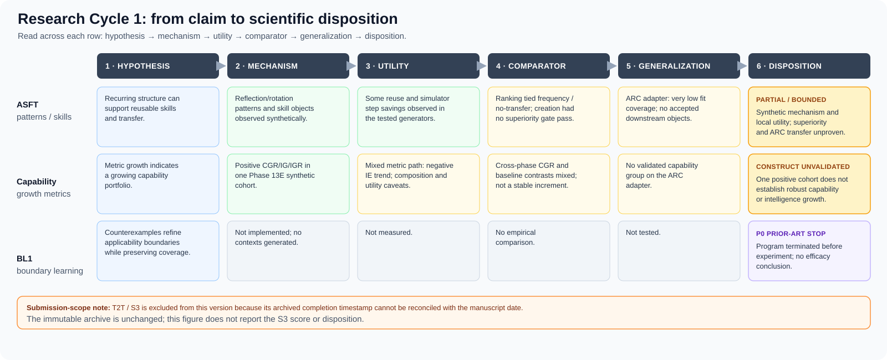

# Evaluating Claims, Not Just Systems
## A Longitudinal Audit of an ARC Research Program

**Manuscript status:** submission-facing draft; excludes T2T/S3 because its provenance timestamp remains unresolved. Article framing: longitudinal claim-audit case study.  
**Evidence basis:** immutable Research Cycle 1 archive plus a preliminary, purposive prior-literature screen. No new benchmark run, implementation, experiment, or statistical re-analysis is reported.  
**Submission note:** T2T/S3 is omitted from the empirical narrative, abstract, table, and figure; its archived record remains unchanged. See §2.4.  
**Proposed article type:** longitudinal claim-audit case study / empirical evaluation analysis.  

### Abstract

ARC research includes benchmark design, concept-focused evaluation, controlled generalization studies, system comparisons, and component ablations. We present a longitudinal audit of one ARC-motivated research cycle, tracing claims from proposed mechanism through observed utility, comparator tests, generalization attempts, and disposition. In ASFT, recurring operation-level patterns and reflection/rotation skill objects appeared in controlled synthetic tasks, with some measured reuse and simulator-step savings; transfer-aware ranking tied simpler controls, skill-creation policies did not establish incremental superiority, capability metrics were mixed across phases, and a low-coverage ARC-AGI-2 adapter did not activate the downstream mechanism chain. BL1 stopped after a bounded prior-art review, before an efficacy experiment. The central finding is that different claims within the same research program reached different evidence ceilings and therefore require different scientific dispositions. The central contribution is an auditable mapping between claim type, evidence type, and final scientific disposition across one program. This submission version focuses on the traceable ASFT and BL1 paths; T2T/S3 is excluded pending provenance reconciliation.

**Keywords:** ARC-AGI; evaluation methodology; claim-evidence mapping; comparator design; generalization; synthetic task; retrospective case study

## 1. Introduction

A benchmark score, an implemented mechanism, a component ablation, and a transfer claim answer different questions. A system may produce the proposed representation without that representation improving task outcomes; a component may improve a controlled synthetic endpoint without outperforming a stronger alternative; a within-benchmark effect may fail to transfer to a new task family. Treating these as one claim can make evidence appear stronger—or weaker—than it is.

ARC work already contains important evaluation contributions. ConceptARC organizes tasks around concepts and tests abstraction/generalization against human and machine solvers [1]. Controlled ARC-domain studies test compositional generalization across methods [2]. ARC Prize technical reports discuss score interpretation, hidden-set reuse, compute, and benchmark design [3, 4], while method papers include component ablations [5, 6]. This case study builds on that evaluation tradition. Its unit of analysis is the linked research program: how claims move from a proposed mechanism to observed utility, comparison, generalization, and disposition. The accompanying literature screen is purposive, so we make no prevalence claim about ARC papers as a whole.

Instead, we ask a narrower question:

> **What conclusions remain defensible when the claims in one ARC-motivated research cycle are separated by mechanism occurrence, task-relevant utility, incremental superiority, and external generalization?**

Research Cycle 1 moves through linked lines: ASFT develops and tests recurring-structure, skill, transfer, and capability claims; BL1 stops at a prior-art gate. This submission version follows the ASFT and BL1 evidence paths. The separate T2T/S3 record is omitted because its date cannot currently be reconciled; the archive is preserved unchanged.

*Figure 1. Each retained claim is traced across hypothesis, mechanism, utility, comparator, generalization, and disposition. T2T/S3 is excluded from this submission version pending provenance reconciliation.*

We contribute a **retrospective application** of a claim ladder and an evidence ledger. The case's value is its traceable disposition map: positive observations, failed superiority tests, mixed metrics, blocked transfer, and a pre-experiment novelty decision remain distinct rather than collapsing into a single success/failure narrative.

## 2. Scope and audit method

### 2.1 Research lines included

The submission analyzes two linked evidence paths plus the cycle closure:

- **ASFT:** the saved Phase 13–14 synthesis of synthetic prototypes, comparator studies, capability metrics, and the bounded ARC-AGI-2 adapter.
- **BL1:** a bounded P0 prior-art review of counterexample-guided applicability-boundary learning. No implementation or experiment occurred.
- **Research Cycle 1 closure:** the disposition record and decision not to authorize a descendant research program.

**Excluded for provenance:** T2T/S3 is not used as empirical evidence in this version because the immutable execution record's completion date cannot be reconciled with the manuscript date. The archive remains untouched; see `s3_provenance_date_reconciliation.md`.

Later ASFT v1.1 candidate-production readiness work is mentioned only as readiness/plumbing context. It is not an ARC efficacy result: independent annotation was incomplete and no real ARC candidate-production run occurred.

### 2.2 Claim ladder

We use the following ladder as an **organizing lens**, not a validated measurement framework:

1. **Mechanism present:** did the software or method produce the proposed object/operation in the specified setting?
2. **Task-relevant utility:** did the object or operation contribute to a relevant outcome, such as success or a cost proxy, in that setting?
3. **Incremental superiority:** did the proposed mechanism improve the outcome over an appropriate, sufficiently strong comparator under a matched protocol?
4. **External generalization:** did the result hold beyond the development generator, benchmark split, or narrowly tested model/task condition?

The ladder is not always strictly sequential. A pre-experiment prior-art decision, for example, is not evidence for or against any of the four empirical layers. Nor does a utility effect automatically establish policy superiority: the observed utility may be available to simpler baselines as well.

### 2.3 Evidence categories and source records

Each audited conclusion is labeled as one of the following:

- **Narrow synthetic support:** an operational behavior occurred in a controlled, known generator; external validity and superiority remain separate questions.
- **Comparative support/failure:** a frozen contrast met or failed its stated criterion on its specified benchmark and estimand.
- **Mixed / partial:** support varies across measures, phases, comparators, or related constructs.
- **Unavailable / blocked:** a required candidate, label, component, or run was absent. This is not a null effect.
- **Prior-art termination:** a proposed contribution was judged substantially covered before testing. This is not an experimental result.

The synthesis uses the saved Phase 13H and Phase 14J packages, the BL1 P0 review, and the Research Cycle 1 closure. It does not pool outcomes across different generators, endpoints, candidate pools, or seed structures; no new effect estimate is calculated. Earlier artifacts are not modified. The literature screen reported separately in `claim_isolation_prior_art.md`, `arc_comparator_survey.md`, and `arc_evaluation_methodology_review.md` is purposive, not systematic, and is used only to qualify the novelty framing.

### 2.4 Provenance boundary

The separate immutable S3 execution record contains a completion timestamp of 2026-11-05, later than the manuscript date 2026-10-28. No independent contemporaneous source resolving the discrepancy has been provided or verified for this draft. Accordingly, this version excludes all T2T/S3 results and dispositions from its scientific evidence. The archive remains unchanged; any future reinstatement requires independent date verification and a separate provenance note.

### 2.5 Comparison discipline

- A primary tie is not evidence of equivalence beyond the frozen test.
- A negative result is restricted to its stated estimand and decision rule.
- A synthetic result is not an ARC result.
- An implementation/readiness pass is not efficacy evidence.
- An unavailable endpoint is not zero effect.
- A prior-art stop is not an experimental failure.
- A cross-paper score table is not a matched causal comparison unless data, model, budget, and protocol are aligned.

## 3. Case findings through the claim ladder

### 3.1 ASFT: occurrence and local utility did not establish incremental superiority

Within controlled synthetic task generators, the implemented pipeline detected recurring operation-level patterns, formed reflection/rotation skill objects, recorded successful reuse, and measured reductions in a simulator reasoning-step proxy. Phase 13C recorded 44 candidate rows across its confirmation seeds, with observed births limited to reflection/rotation. This is **narrow mechanism-occurrence evidence** in designed synthetic environments, not open-ended invariant discovery or external validation.

There was also **bounded local utility evidence**: some skill reuse and simulator-step savings were observed. But these did not establish that the ASFT policies added value over simpler alternatives. Transfer-aware ranking tied frequency-only and no-transfer variants on the original Phase 13B primary top-k comparison. The later injected-no-op stress test was exploratory and does not repair that failed gate. On Phase 13C's primary net-value endpoint, SCT tied ALWAYS_CREATE and RANDOM_CREATE and was below MEMORY_ONLY; the report notes an opportunity-matching caveat. SCV's association with shadow future value did not demonstrate incremental policy benefit over frequency and `p_reuse` controls.

**Claim ceiling:** some mechanisms occurred and some local outcomes improved, but the tested ranking and creation policies did not establish incremental superiority on their main comparisons. ARC generalization is a separate unproven layer.

### 3.2 Capability metrics: positive values were not a validated growth construct

Phase 13E reported positive repository-defined CGR/IG/IGR values and persistent low-order capabilities in one synthetic cohort. The same evidence includes a negative IE trend, zero accepted higher-order emergent capabilities, a non-positive composition-value result, and an adverse ASFT-minus-B1 all-task utility contrast. Corrected Phase 13D reported negative mean CGR across its evaluable seeds; Phase 13F's joint baseline outcome was mixed; and CGR/IG were unavailable in the bounded ARC adapter because no capability group was validated.

**Claim ceiling:** the repository's metrics moved positively in one defined synthetic pathway. Cross-phase consistency, causal transfer-to-capability links, broad capability growth, intelligence growth, and ARC external validity were not established.

### 3.3 The ARC adapter: a non-activated mechanism chain, not a broad ARC falsification

The Phase 13G adapter used a bounded symbolic program language. Exact demonstration-fit coverage was 3/600 discovery, 5/200 transfer, and 2/200 holdout. It produced no accepted invariant candidates, skills, or capabilities; IG was unavailable. Main arms scored equally on holdout exact-task accuracy at 1/200 (0.5%). The saved package also reports a candidate-budget configuration/code mismatch, low coverage, and reuse of the holdout after an earlier attempt generated predictions before a report-writing failure.

This is best described as a **coverage-limited, non-activation outcome**: the proposed downstream chain was not demonstrated on this adapter. It is not a clean causal demonstration that invariant representations cannot work on ARC, and it is not an ARC-AGI-3 result. ARC reports themselves distinguish benchmark versions and evaluation settings; claims must be scoped to the particular set and protocol [3, 4].

### 3.4 BL1: prior-art gate prevented a test

BL1 proposed the chain counterexample evidence → improved applicability-boundary precision → maintained useful coverage. The bounded P0 review found substantial prior art in counterexample-guided refinement and direct overlap with learned option initiation sets from successful/failed examples, including concerns about useful coverage [7–9]. BL1 terminated at P0 before implementation, context generation, or experiment.

**Claim ceiling:** novelty was not defensible for the proposed framing under the bounded review. There is no BL1 experimental evidence for or against boundary-update efficacy. The S2 toy observation remains a toy observation only.

### 3.5 Claim-disposition table

**Table 1. Claim-level evidence and disposition in Research Cycle 1.**

| Claim | Evidence type and result | Disposition | Claim ceiling |
|---|---|---|---|
| Pattern discovery | Synthetic; recurring operation signatures observed | **PARTIAL SUPPORT** | Generator-bounded; no external validation |
| Skill formation and reuse | Synthetic; reflection/rotation skills and step savings observed; creation-policy gates tied/failed | **MIXED** | Local utility does not establish policy superiority or ARC transfer |
| Capability growth | Mixed synthetic metrics across phases; no validated capability group on ARC adapter | **UNVALIDATED CONSTRUCT** | Positive metric values in one cohort do not establish robust capability or intelligence growth |
| ARC transfer | Bounded adapter; low coverage and no accepted downstream objects | **NOT DEMONSTRATED** | Coverage-limited non-activation, not broad ARC falsification |
| BL1 boundary learning | Bounded prior-art review; no implementation or experiment | **TERMINATED AT P0** | Novelty/program decision only; no efficacy conclusion |

## 4. Lessons from the claim audit

### 4.1 Occurrence is not contribution

ASFT produced recurring operation signatures and reflection/rotation skill objects in its synthetic generators. That establishes that specified operations occurred in the tested setting. It does not, by itself, show that the operations improve outcomes or add value beyond a simpler system. The archive makes this distinction visible by recording mechanism production separately from downstream policy comparisons.

### 4.2 Utility is not superiority

Some reuse and simulator-step savings were observed in the synthetic tasks. Those are task-relevant local outcomes, but they do not establish that ASFT's ranking or creation policy is the source of an incremental gain. Transfer-aware ranking tied frequency-only and no-transfer controls on its primary comparison. Skill-creation policies did not clear their primary superiority gate; MEMORY_ONLY was stronger on the reported endpoint, subject to the archive's opportunity-matching caveat. Thus utility can be present while policy superiority remains unsupported.

### 4.3 Superiority is not generalization

A comparator result is tied to its task population, endpoint, and protocol. It cannot by itself establish transfer to another generator or benchmark version. Here, the ARC-AGI-2 adapter had very low fit coverage and produced no accepted downstream objects, so the proposed chain was not demonstrated on that adapter. This is a coverage-limited transfer result—not evidence that the mechanism is impossible on ARC, and not a general ARC falsification.

### 4.4 Empirical outcomes are not all the same disposition

The retained records include partial synthetic support, failed or tied superiority gates, mixed capability metrics, a blocked or non-activated ARC endpoint, and BL1's prior-art stop before experiment. The prior-art decision answers a novelty question; the blocked endpoint describes unavailable empirical evidence; neither is an efficacy negative. Keeping these dispositions separate is what makes the program's final evidence map interpretable.

### 4.5 Relationship to ARC evaluation work

The present manuscript sits alongside, rather than replaces, existing ARC evaluation research. ConceptARC tests concept-focused understanding and generalization [1]; Ouellette studies controlled compositional generalization [2]; ARC Prize technical reports discuss benchmark design and score interpretation [3, 4]; and ARC method papers include component ablations [5, 6]. A recent living-survey preprint also treats evaluation practice as an explicit topic [10], though its coding and numerical claims should be checked before they are used as field-wide estimates.

Our distinction is the **unit of synthesis**: we trace multiple claims and evidence categories across one archived research cycle. The preliminary literature screen is not designed to establish priority or field-wide prevalence.

### 4.6 Limitations

The evidence base is heterogeneous and mostly generated in a bespoke synthetic framework. The task generators and solver vocabularies were known to the researchers. Several ASFT studies use small seed counts, constructed candidate pools, or phase-specific endpoints, so findings cannot be pooled into one effect estimate. The ARC adapter was coverage-limited and had disclosed configuration/holdout caveats. BL1's prior-art review was bounded, not systematic. No independent laboratory replicated this research cycle. T2T/S3 is excluded from this submission version because its execution record's date discrepancy could not be independently reconciled.

The retrospective synthesis is vulnerable to selection and narrative bias because the same project lineage produced the archive and the present account. The external literature screen is purposive, not systematic, and cannot estimate field prevalence. The case study is limited to the dispositions supported by its retained records.

## 5. Conclusion

Research Cycle 1 yields a longitudinal disposition map: mechanism occurrence, local utility, comparative superiority, ARC transfer, and prior-art novelty reach different evidence boundaries. The audit shows how one program can contain positive observations, failed superiority tests, mixed metrics, a blocked transfer endpoint, and a pre-experiment novelty stop without reducing them to a single success/failure verdict.

The paper's contribution is a traceable claim-level account of that research cycle and a compact way to read its evidence—hypothesis → mechanism → utility → comparator → generalization → disposition. The submission version focuses on the ASFT and BL1 paths; T2T/S3 is excluded pending provenance reconciliation. The case study's scope is this program, while broader application of the claim-audit lens remains an open question.

## Data and audit trail

No new experimental data are reported. The manuscript relies on immutable records:

- `reports/experiments/PHASE-14J-FINAL-SCIENTIFIC-CONCLUSIONS-V1/` — final ASFT synthesis and claim ceiling.
- `reports/experiments/PHASE-13H-EVIDENCE-CONSOLIDATION-V1/` — phase evidence packages and tables.
- `research_cycle_claim_audit_timeline.svg` — claim-by-claim map across hypothesis, mechanism, utility, comparator, generalization, and disposition.
- `s3_provenance_date_reconciliation.md` — documents why T2T/S3 is excluded from this submission version; the archived execution record remains unchanged.
- `docs/05_trace_to_transfer/bl1/boundary_prior_art_review.md` — BL1 P0 prior-art decision.
- `research_asset_inventory.md`, `arc_research_landscape_review.md`, `candidate_phenomena_ranking.md`, and `research_cycle_1_closure.md` — cycle inventory, landscape, ranking, and closure.
- `claim_isolation_prior_art.md`, `arc_comparator_survey.md`, `venue_landscape.md`, and `arc_evaluation_methodology_review.md` — preliminary literature and venue screens; not systematic reviews.

The original artifacts are to remain unchanged. Any correction to provenance should be documented separately and linked rather than silently editing the archived execution record.

## References

1. Moskvichev, A., Odouard, V. V., & Mitchell, M. (2023). “The ConceptARC Benchmark: Evaluating Understanding and Generalization in the ARC Domain.” *Transactions on Machine Learning Research*. https://arxiv.org/abs/2305.07141
2. Ouellette, S. (2025). “Out-of-Distribution Generalization in the ARC-AGI Domain: Comparing Execution-Guided Neural Program Synthesis and Test-Time Fine-Tuning.” *arXiv:2507.15877*. https://arxiv.org/abs/2507.15877
3. Chollet, F., Knoop, M., Kamradt, G., & Landers, B. (2025). “ARC Prize 2024: Technical Report.” https://arxiv.org/abs/2412.04604
4. Chollet, F., Knoop, M., Kamradt, G., & Landers, B. (2026). “ARC Prize 2025: Technical Report.” https://arxiv.org/abs/2601.10904
5. Franzen, D., Disselhoff, J., & Hartmann, D. (2025). “Product of Experts with LLMs: Boosting Performance on ARC Is a Matter of Perspective.” *ICML 2025*. https://arxiv.org/abs/2505.07859
6. Moghe, K., & Chin, P. (2026). “Cost-Effective Agent Harnesses for Abstract Reasoning and Generalization on ARC-AGI-1.” *arXiv:2607.06764*. https://arxiv.org/abs/2607.06764
7. Clarke, E. M., Grumberg, O., Jha, S., Lu, Y., & Veith, H. (2000). “Counterexample-Guided Abstraction Refinement.” In *Computer Aided Verification (CAV 2000)*, LNCS 1855, pp. 154–169. https://web.stanford.edu/class/cs357/cegar.pdf
8. Solar-Lezama, A. (2009). “The Sketching Approach to Program Synthesis.” In *Programming Languages and Systems (APLAS 2009)*, LNCS 5904, pp. 4–13. https://doi.org/10.1007/978-3-642-10672-9_3
9. Bagaria, A., Abbatematteo, B., Gottesman, O., Corsaro, M., Rammohan, S., & Konidaris, G. (2023). “Effectively Learning Initiation Sets in Hierarchical Reinforcement Learning.” *NeurIPS 2023*. https://proceedings.neurips.cc/paper_files/paper/2023/file/e8da56eb93676e8f60ed2b696e44e7dc-Paper-Conference.pdf
10. Vahdati, S., Aioanei, A., Suresh, H., & Lehmann, J. (2026). “The ARC of Progress towards AGI: A Living Survey of Abstraction and Reasoning.” *arXiv:2603.13372*, preprint. https://arxiv.org/abs/2603.13372

---

**Editorial note:** Avoid “the missing layer in ARC research” and “most ARC work evaluates systems rather than claims” unless a reproducible, systematically coded corpus review later supports those statements. The current defensible thesis is that this paper uses claim-level evaluation to make one research cycle's evidence boundaries visible.