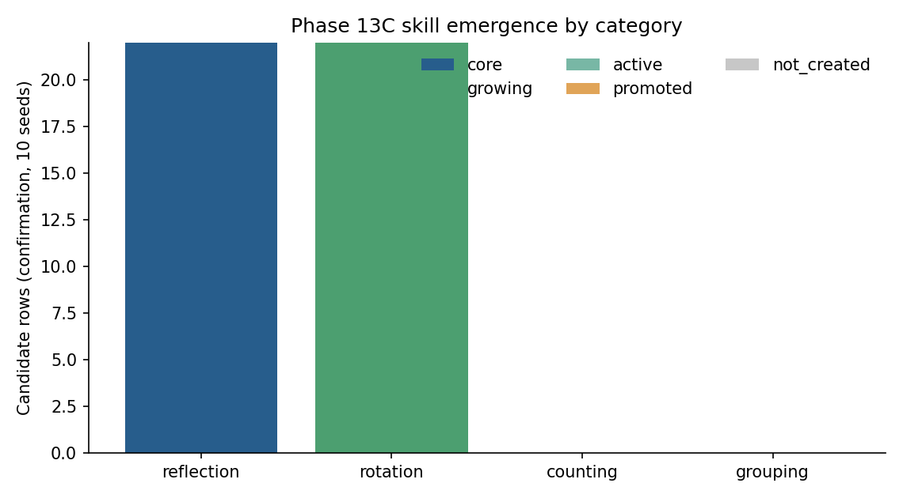
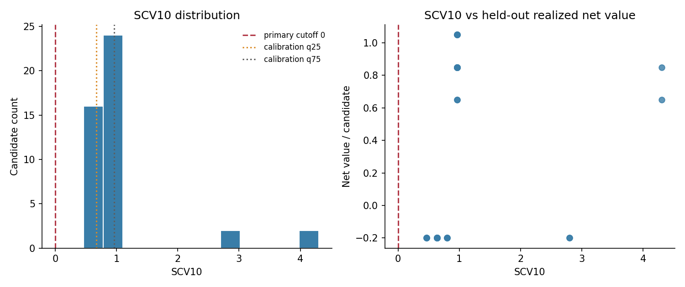
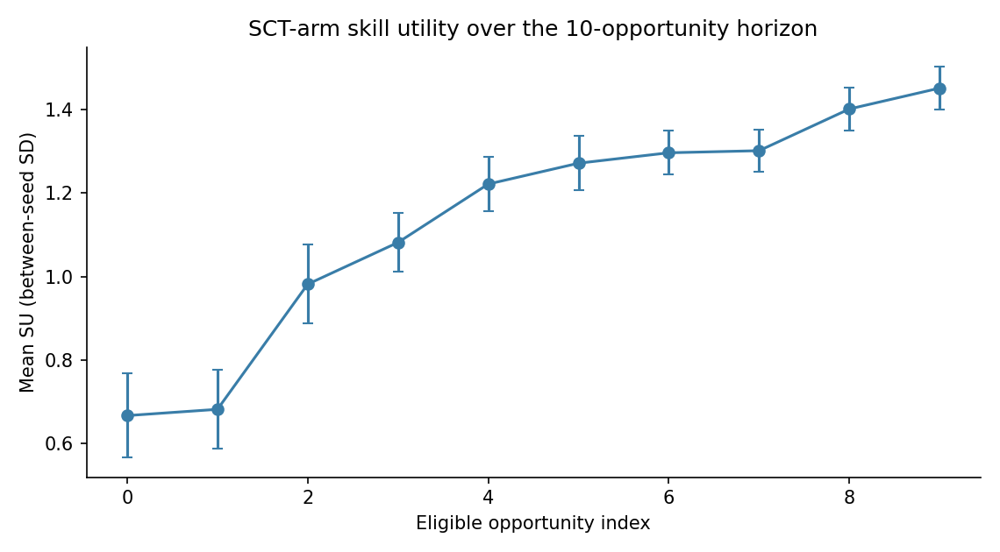
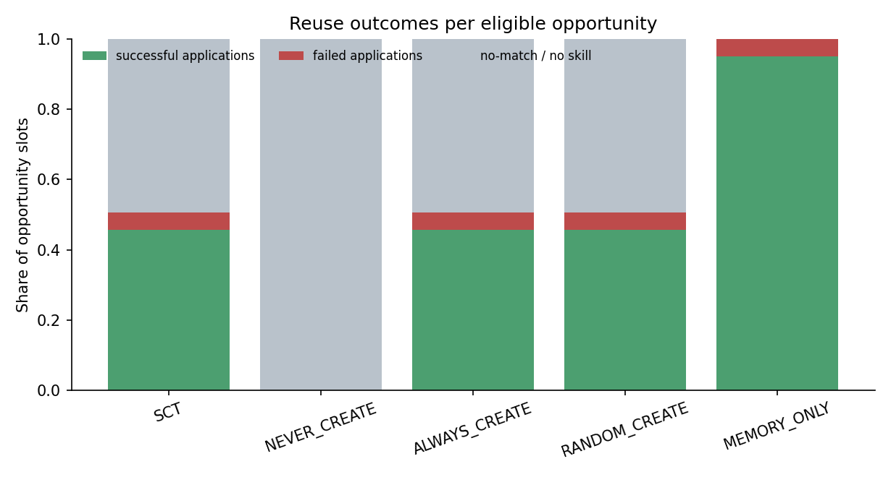
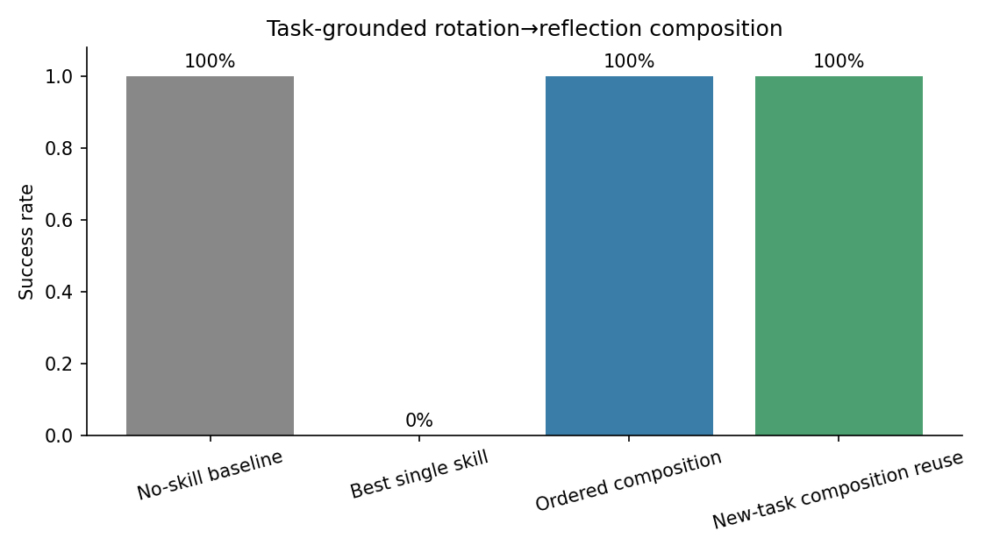
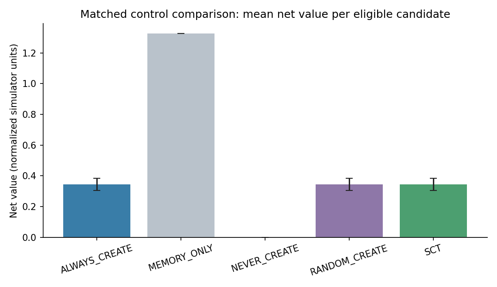
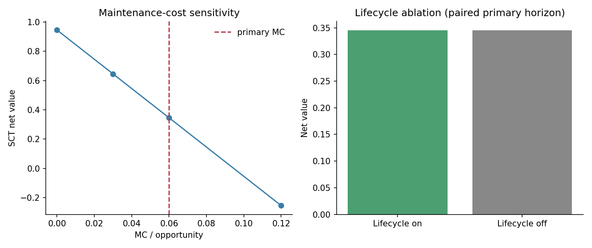

# Phase 13C v1 — evidence package

## Scope and execution integrity

Confirmatory record: synthetic-sct-v1, seeds 20–29 (10 independent run seeds). Calibration: seeds 15–19. The frozen task/cost protocol is archived as `preregistration_v1_frozen_preconfirmation.md`; the post-run documentation banner is status-only. The pre-confirmation implementation/config hash manifest is `pre_confirmation_freeze.json`.

This is controlled synthetic evidence conditional on the current invariant/task generator. It does not establish scientific validity on broader tasks or ARC external validity. Historical Phase 13B and EXP-IDT-14 records are not modified or pooled.

**Execution note:** the command-line completion line for `confirm` displayed calibration seeds `[15..19]` because it selected the `calibration_seeds` field first. The saved `record.json` is the source of truth and records confirmation seeds `[20..29]`; no confirmation seed was replaced. This is a reporting-only CLI defect, frozen implementation hash is retained.

The maintenance term `MC=0.06` is a modeled normalized per-opportunity simulator cost, not empirical compute cost.

## 1. Skill emergence and births

The confirmation candidate pool contained 44 eligible candidate rows over 10 seeds, with 6 unique signatures observed across rows. SCT selected and instantiated all 44 rows; terminal states were `{'growing': 22, 'core': 22}`. Categories: `{'rotation': 22, 'reflection': 22}`. Counting and grouping had zero births under the frozen eligibility/minimum-quality gates; they are retained as absent categories rather than forced into the table.

| Candidate category | Confirmation rows |
|---|---:|
| reflection | 22 |
| rotation | 22 |
| counting | 0 |
| grouping | 0 |

## 2. SCV10, threshold study, and held-out predictiveness

Calibration yielded 22 eligible candidates; all 22 had SCV10 > 0. Frozen random-create probability was 1.000. Calibration score cutoffs were low q25=0.675000, median=0.966667, high q75=0.966667; median and upper quartile tie. The random arm therefore degenerates to always-create on this calibration result.

| Confirmatory selection cutoff | Frozen numeric cutoff | Selected candidate rows | Mean per-seed net value (shadow outcomes) |
|---|---:|---:|---:|
| high_q75 | 0.966667 | 4/44 | 0.018 |
| low_q25 | 0.675000 | 28/44 | 0.418 |
| medium_q50 | 0.966667 | 4/44 | 0.018 |
| primary | 0.000000 | 44/44 | 0.345 |

Selection sensitivity uses isolated shadow outcomes; it is not a post-hoc replacement for the primary policy or an outcome-selected threshold.

| Predictor of shadow realized net value | Spearman ρ | Seed-cluster bootstrap 95% CI |
|---|---:|---:|
| AG | -0.074 | -0.110 to 0.000 |
| SCV10 | 0.700 | 0.545 to 0.931 |
| TS | 0.000 | 0.000 to 0.000 |
| frequency | 0.748 | 0.709 to 0.885 |
| p_reuse | 0.884 | 0.874 to 0.937 |

## 3. Utility and future value

SCT skill utility rose from mean SU 0.678 after the first eligible opportunity to 1.459 after the tenth. This is secondary accounting, not the primary value measure. Candidate-level utility-component checkpoints (RCG/TV/CP/RV/CC/MC/NR/SU) are retained in `utility_trajectories.csv`.
Limitation: a distinct pre-task birth-time SU/component snapshot was not serialized by the runner; task index 0 is after the first eligible opportunity and must not be relabeled as birth utility.

| Descriptive utility association | Spearman ρ | Seed-cluster bootstrap 95% CI |
|---|---:|---:|
| SU_vs_cross_family_transfer | 0.922 | 0.904 to 0.960 |
| SU_vs_future_net_value | 0.937 | 0.897 to 1.000 |
| SU_vs_reuse_count | 0.937 | 0.898 to 1.000 |

## 4. Reuse, reasoning reduction, and transfer

| Arm | Eligible opportunities | Applied | Correct | Failed | No match | Positive-credit reuses | Reused/created skills* | Correct / eligible |
|---|---:|---:|---:|---:|---:|---:|---:|---:|
| SCT | 440 | 223 | 201 | 22 | 217 | 201 | 44/44 | 0.457 |
| MEMORY_ONLY | 440 | 440 | 418 | 22 | 0 | 418 | 44/44 | 0.950 |
| ALWAYS_CREATE | 440 | 223 | 201 | 22 | 217 | 201 | 44/44 | 0.457 |
| RANDOM_CREATE | 440 | 223 | 201 | 22 | 217 | 201 | 44/44 | 0.457 |
| NEVER_CREATE | 440 | 0 | 0 | 0 | 440 | 0 | n/a | 0.000 |

For SCT, mean raw step saving among applied task rows was 1.000; mean normalized reduction among correct applications was 0.227. Correctness is reported separately; the cost scalar gives zero benefit to incorrect replays.

For MEMORY_ONLY, mean raw step saving among applied task rows was 1.000; mean normalized reduction among correct applications was 0.213. Correctness is reported separately; the cost scalar gives zero benefit to incorrect replays.

*Reused/created means at least one positive-credit reuse divided by created candidate instances; memory-only rows are trace exemplars, not Skill objects. Memory-only failed applications are derived from saved task rows because the runner's aggregate omitted its failure count. The per-task value calculation itself remains success-gated.

| Source→target family transfer | Correct applications |
|---|---:|
| SCT | 91 / 91 attempted cross-family applications (91 positive-credit) |
| MEMORY_ONLY | 308 / 308 attempted cross-family applications (308 positive-credit) |

## 5. Task-grounded composition and reuse

Only rotation→reflection was evaluable because counting and grouping component skills were absent. Across 100 paired task instances, the no-skill composition-capable solver succeeded 100.0%, the best single component skill succeeded on 0.0%, and ordered rotation→reflection succeeded 100.0%; mean success-gated normalized reasoning reduction was 0.429. All 10/10 separately seeded composition-reuse tasks succeeded. Candidate state was reusable in all evaluable cases.

The two planned counting-containing compositions were not evaluable; their missing-component status is preserved. These outcomes establish synthetic composition plumbing only; the research composition module is not silently treated as a general multi-step Skill in the primary policy.

## 6. Matched primary controls

| Arm | Mean net value | SD | Normal 95% CI | Seed-bootstrap 95% CI |
|---|---:|---:|---:|---:|
| ALWAYS_CREATE | 0.345 | 0.063 | 0.306 to 0.384 | 0.305 to 0.385 |
| MEMORY_ONLY | 1.325 | 0.000 | 1.325 to 1.325 | 1.325 to 1.325 |
| NEVER_CREATE | 0.000 | 0.000 | 0.000 to 0.000 | 0.000 to 0.000 |
| RANDOM_CREATE | 0.345 | 0.063 | 0.306 to 0.384 | 0.305 to 0.385 |
| SCT | 0.345 | 0.063 | 0.306 to 0.384 | 0.305 to 0.385 |

| Policy | Created skills / stored exemplars | Total CC proxy | Total MC proxy | Mean created items per seed |
|---|---:|---:|---:|---:|
| SCT | 44 skills | 4.400 | 26.400 | 4.400 |
| NEVER_CREATE | 0 skills | 0.000 | 0.000 | 0.000 |
| ALWAYS_CREATE | 44 skills | 4.400 | 26.400 | 4.400 |
| RANDOM_CREATE | 44 skills | 4.400 | 26.400 | 4.400 |
| MEMORY_ONLY | 44 raw-trace exemplars | 4.400 | 26.400 | 4.400 |

CC/MC are normalized model-cost terms, not empirical compute usage.

| Paired contrast (SCT − control) | Mean | SD | Seed-bootstrap 95% CI | Cohen dz |
|---|---:|---:|---:|---:|
| NEVER_CREATE | 0.345 | 0.063 | 0.305 to 0.385 | 5.455 |
| ALWAYS_CREATE | 0.000 | 0.000 | 0.000 to 0.000 | undefined (zero variance) |
| RANDOM_CREATE | 0.000 | 0.000 | 0.000 to 0.000 | undefined (zero variance) |
| MEMORY_ONLY | -0.980 | 0.063 | -1.020 to -0.940 | -15.495 |

**Strict superiority gate: False (failed).** SCT ties ALWAYS_CREATE and RANDOM_CREATE exactly because every eligible candidate scored above zero in both calibration and confirmation; it is not better than the memory-only arm (paired mean difference -0.980).

## 7. Ablations and cost sensitivity

| Ablation | Matched outcome | Result |
|---|---|---:|
| No-SCV (ALWAYS_CREATE) | Mean primary net value; SCT-minus-ablation | 0.345; 0.000 |
| No-lifecycle | Lifecycle-off mean net; enabled-minus-disabled | 0.345; 0.000 |
| No-composition (best single) | Success vs ordered composition on evaluable tasks | 0.0% vs 100.0% |

No-composition results are secondary and only available for the rotation→reflection case; counting-containing cases were unavailable because component skills did not emerge.

| MC per eligible opportunity | SCT mean net value | 95% normal CI |
|---:|---:|---:|
| 0.00 | 0.945 | 0.906 to 0.984 |
| 0.03 | 0.645 | 0.606 to 0.684 |
| 0.06 | 0.345 | 0.306 to 0.384 |
| 0.12 | -0.255 | -0.294 to -0.216 |

## Overall interpretation

Phase 13C does not pass its predeclared SCT superiority criterion. Within this synthetic design, SCT creates every eligible candidate and is therefore operationally identical to always-create; calibration-frozen random-create is also always-create. The learned skill policy has positive net value versus never-create, but memory-only trace retrieval yields higher mean net value. Skill utility and SCV10 are associated with held-out value in this dataset, but predictor correlations do not rescue the failed policy contrast. Composition works for one evaluable pair and lifecycle dormancy/reactivation is mixed. None of these results repairs Phase 13B or establishes ARC external validity.

## Artifact and limitation index

- `record.json`: full confirmatory record, seed-level outcomes, candidate/task rows, and failures.
- `calibration.json` / `calibration_frozen.json`: calibration-only data and frozen calibration parameters.
- `skill_births.json`, `candidate_level.csv`, `reuse_statistics.csv`, `utility_trajectories.csv`, `lifecycle.csv`, `composition.csv`, `matched_controls.csv`, `threshold_sensitivity.csv`, `mc_sensitivity.csv`, `lifecycle_ablation.csv`: detailed evidence tables.
- `pre_confirmation_freeze.json`: pre-confirmation hashes and contract-test status.
- `preregistration_v1_frozen_preconfirmation.md`: exact protocol copy before confirmation.
- `refactor_manifest.json`: post-run module refactor verification and per-file line counts.
- `source_snapshot/snapshot_manifest.json`: frozen source fragment hashes/reassembly order.
- `execution_note.md`: CLI print correction and metric caveat.
